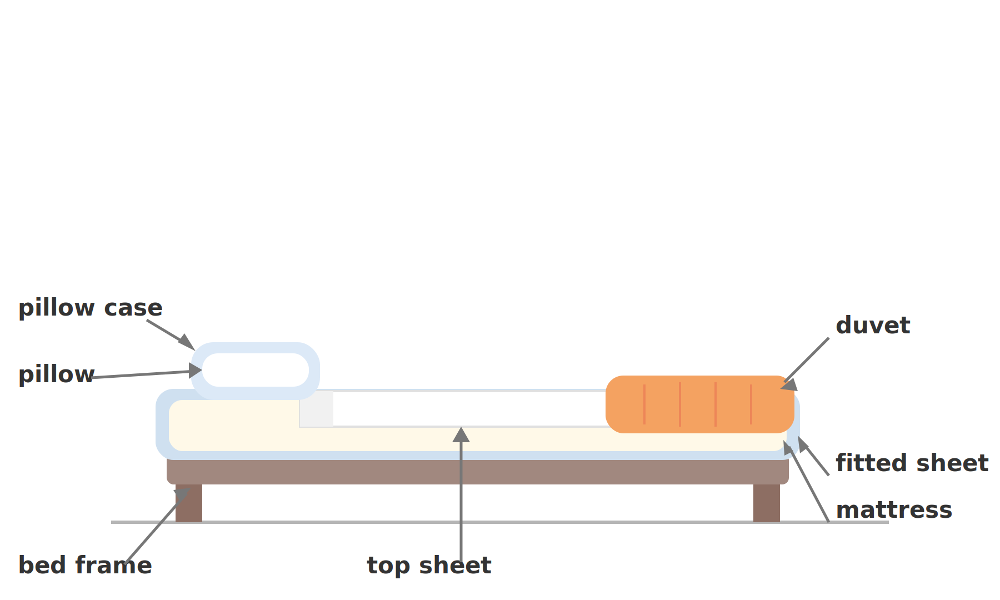
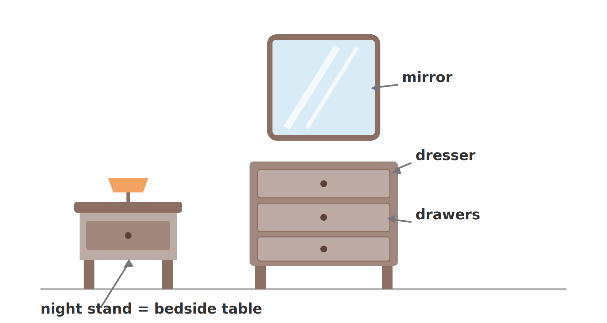
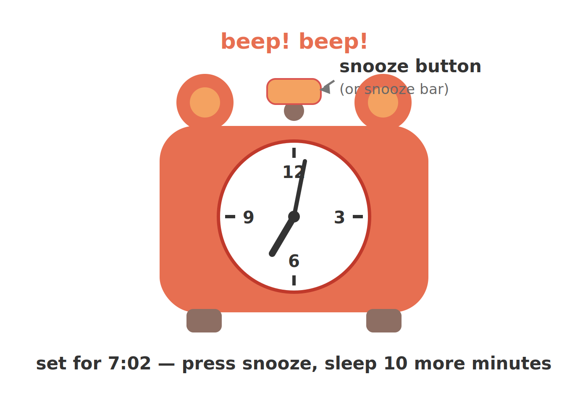
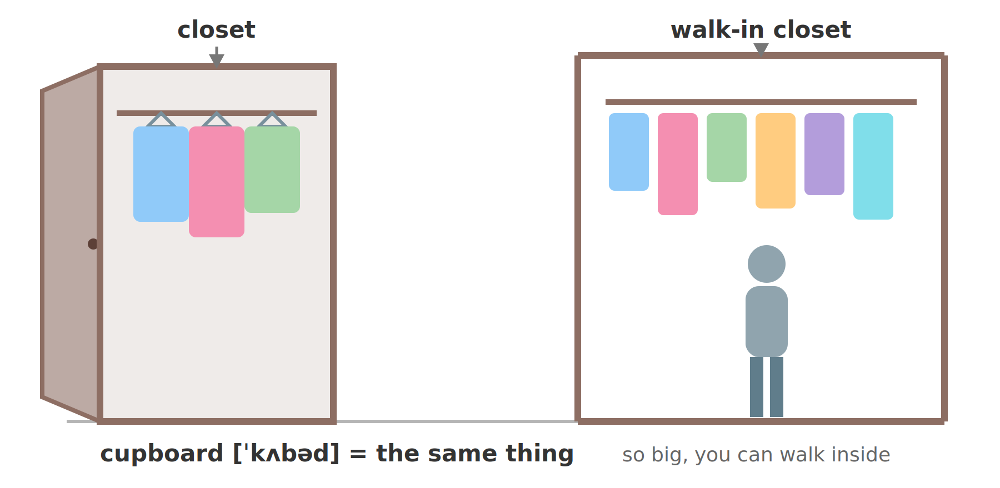

# 1. English Vocabulary — In the Bedroom (Study Notes)

> Teacher: Ronnie (English with Ronnie / engVid)
> Source: video "1. English Vocabulary - In the bedroom"
> The notes follow the themes of the lesson, in order.

**How to read these notes:** phonetics in **[ ]** are British IPA. **Bold words** are the words this lesson teaches — each has a simple English explanation, and the important topic words also have a small Chinese meaning in parentheses at the end.

---

## 1. A bed, and a futon

Ronnie's "bedroom" is really a whiteboard. She starts with the bed and the futon — a Japanese word that English "stole". A futon is a mattress you put on the floor. It sounds uncomfortable, but if you are really drunk it is perfect: you can never fall out of it.

**Lesson words:**
- **bed** [bed] — the thing you sleep on（床）
- **futon** [ˈfjuːtɒn] — a mattress that you put on the floor; English borrowed this word from Japanese（日式床垫）
- **mattress** [ˈmætrəs] — the big, soft part of a bed that you lie on（床垫）
- **bed frame** [bed freɪm] — the hard part under the mattress that holds it up（床架）
- **to fall out of bed** — to roll off the bed by accident（从床上掉下来）
- **to roll over** — to turn your body to the other side when you are lying down（翻身）

## 2. The pillow

Ronnie jokes that many students have never learned this word! A pillow is the soft thing you put your head on. To keep it clean, you put a pillow case on it — and please wash it. Pillows can be feather pillows, fluffy cotton, or microfiber.

**Lesson words:**
- **pillow** [ˈpɪləʊ] — a soft thing you put your head on when you sleep（枕头）
- **pillow case** [ˈpɪləʊ keɪs] — a cloth cover for the pillow; you can take it off and wash it（枕套）
- **squishy** [ˈskwɪʃi] — soft and easy to press with your fingers
- **fluffy** [ˈflʌfi] — soft and light, like a cloud
- **microfiber** [ˈmaɪkrəʊˌfaɪbə] — a man-made material made of very thin threads

## 3. Sheets — be careful!

The next essential thing for a bed is sheets. ⚠️ **Pronunciation trap:** do not say "shit" [ʃɪt] — say "sheets" [ʃiːts] with a long "ee". Usually there are two: the top sheet (the flat one that lies on top of you) and the fitted sheet (the bottom one that covers the mattress).

**Lesson words:**
- **sheets** [ʃiːts] — the thin cloth covers on a bed（床单）
- **top sheet** [tɒp ʃiːt] — the flat sheet that lies on top of you（盖单）
- **fitted sheet** [ˈfɪtɪd ʃiːt] — the bottom sheet that covers the mattress（床笠）

## 4. Duvet, comforter, quilt, blanket, cover

In winter you need something warm. Sheets are very thin (usually cotton), so you add a cover. The problem: English has many words for this — and they are all almost the same thing. ⚠️ "Duvet" is a French word: say [ˈduːveɪ] ("do-vay"), NOT "do-vet". Ronnie's homework: go to a store and ask the staff to show you each one — that is English practice too.

**Lesson words:**
- **duvet** [ˈduːveɪ] — a soft, thick, warm bed cover; a French word, so the spelling and the sound do not match（羽绒被）
- **comforter** [ˈkʌmfətə] — another word for a thick, warm bed cover（厚被子）
- **quilt** [kwɪlt] — a warm cover made of two layers of cloth with soft filling inside（绗缝被）
- **blanket** [ˈblæŋkɪt] — a warm cover for the bed（毯子）
- **cover** [ˈkʌvə] — the general word for the warm thing on your bed（床罩）

## 5. Furniture: night stand, bedside table and dresser

The next thing in the bedroom is furniture — and furniture is an **uncountable noun**: you cannot say "a furniture" or "two furnitures"; say "a piece of furniture". A night stand (or bedside table) is the small table beside your bed. A dresser is the furniture with drawers where you keep clean clothes — beautifully folded-up underwear and socks!

**Lesson words:**
- **furniture** [ˈfɜːnɪtʃə] — the things in a room: beds, tables, chairs... (uncountable noun)（家具，不可数名词）
- **night stand** [naɪt stænd] / **bedside table** [ˈbedsaɪd ˌteɪbl] — a small table next to the bed; both names mean the same thing（床头柜）
- **dresser** [ˈdresə] — a piece of furniture with drawers, where you keep clean clothes（五斗柜）
- **drawers** [drɔːz] — the box parts of furniture that slide in and out（抽屉）

## 6. The mirror

A mirror shows your own face back to you — that image is your reflection. It is most common in the bathroom, but bedrooms have one too: people like to look at themselves and make sure everything is in the right place.

**Lesson words:**
- **mirror** [ˈmɪrə] — glass that shows your face when you look at it（镜子）
- **reflection** [rɪˈflekʃn] — the image of you that you see in the mirror（映像）

## 7. The alarm clock and the snooze button

Ronnie calls the alarm clock a "contraption made by Satan" — a joke, because nobody likes waking up. ⚠️ **Pronunciation trap:** say "alarm clock" [əˈlɑːm klɒk] with a clear "l" — if you say "alarm cock", "cock" [kɒk] is a very rude word. The magic button is the snooze button (or snooze bar): press it and you get ten more minutes of sleep. "I hit the snooze five times, that's an hour" is a classic excuse for being late.

**Lesson words:**
- **alarm clock** [əˈlɑːm klɒk] — a clock that makes a loud noise (beep!) to wake you up（闹钟）
- **snooze button** [snuːz ˌbʌtn] / **snooze bar** [snuːz ˌbɑː] — the button that gives you about 10 more minutes of sleep（贪睡按钮）
- **contraption** [kənˈtræpʃn] — a machine or device, often a strange or funny one
- **luscious** [ˈlʌʃəs] — very pleasant and enjoyable
- **to go off** — (for an alarm or bell) to start making a sudden loud noise（闹钟响了）
- **to hit the snooze** — to press the snooze button（按贪睡按钮）

## 8. Closet, walk-in closet and cupboard

A closet is a small room with a door where you hang your clothes. If you are lucky, you have a walk-in closet — so big it is like a whole other room. (Ronnie's closet is scary: "Don't open it — you never know what's gonna come flying out!") Another word for closet is cupboard — ⚠️ it looks like "cup-board", but we say [ˈkʌbəd] ("cub-berd")!

**Lesson words:**
- **closet** [ˈklɒzɪt] — a small room with a door, where you hang your clothes（壁橱/衣柜）
- **walk-in closet** [ˈwɔːk ɪn ˌklɒzɪt] — a very big closet you can walk inside, like a small room（步入式衣帽间）
- **cupboard** [ˈkʌbəd] — another word for closet; the spelling and the sound are very different（橱柜）
- **to hang your clothes** [hæŋ] — to put clothes on hangers inside a closet（挂衣服）

---

## 9. Sentence analysis: find the trunk, then the adverbs

Native speakers do not read word by word. They grab the **subject + verb** (the trunk) first, then hang the modifiers on it. Here is the method, practiced on real sentences from the lesson:

1. Find **S + V** — the smallest complete idea.
2. Find the **adverbs** — and ask what each one changes: the verb? an adjective? the whole sentence?
3. Find the **clauses** and **prepositional phrases** — each one answers a question (when? where? which one? how?).

### 9.1 "Well, it's not **actually** my bedroom."
- **Trunk:** **it** (subject) + **is** (verb) → "it is (not) my bedroom"
- **actually** [ˈæktʃuəli] — sentence adverb → modifies the whole clause: "this is the real fact" (maybe not what you expected). "Well" is only a spoken filler.

### 9.2 "Stay tuned — **maybe** I'll teach you some other bedroom vocabulary **later**, if you know what I mean."
- **Trunk:** **I** (subject) + **will teach** (verb)
- **maybe** [ˈmeɪbi] — sentence adverb → modifies the whole main clause (uncertainty: "perhaps").
- **later** [ˈleɪtə] — time adverb → modifies **will teach** (answers WHEN).

### 9.3 "When you sleep, you **usually** sleep on a futon."
- **Trunk:** **you** (subject) + **sleep** (verb)
- **usually** [ˈjuːʒuəli] — frequency adverb → modifies **sleep** (answers HOW OFTEN).
- Modifiers: "When you sleep" — time clause → modifies "sleep" (WHEN); "on a futon" — prepositional phrase → modifies "sleep" (WHERE).

### 9.4 "A futon, if you don't know, is **basically** a mattress that you put on the floor."
- **Trunk:** **A futon** (subject) + **is** (verb)
- **basically** [ˈbeɪsɪkli] → modifies **is**: "in the simplest way" — she is giving the basic definition.
- Modifiers: "if you don't know" — a side comment; "that you put on the floor" — relative clause → modifies **mattress** (WHICH one).

### 9.5 "It sounds **kind of** uncomfortable, but it's **really, really** good if you're **really** drunk."
- **Trunk 1:** **It** + **sounds**; **Trunk 2:** **it** + **is** ("it's" = it is)
- **kind of** → modifies the adjective **uncomfortable**: "a little bit".
- **really, really** → modify the adjective **good**: "very much" (she doubles it for fun).
- **really** (third one) → modifies the adjective **drunk**: "very".
- Key point: adverbs do not only modify verbs — they very often modify **adjectives**.

### 9.6 "A lot of people, I don't know why, have **never** learned this word in English."
- **Trunk:** **A lot of people** (subject) + **have learned** (verb, present perfect)
- **never** [ˈnevə] — frequency adverb → modifies **have learned** ("at no time").
- Modifiers: "I don't know why" — a side comment; "in English" — prepositional phrase → modifies **learned** (WHICH language).

### 9.7 "The fitted sheet **just** means it's the bottom sheet."
- **Trunk:** **The fitted sheet** (subject) + **means** (verb)
- **just** [dʒʌst] — limiting adverb → modifies **means**: "simply / only" — do not think it is something special.

### 9.8 "Sheets are **very** thin — they're **usually** made of cotton."
- **Trunk 1:** **Sheets** + **are**; **Trunk 2:** **they** + **are made** (passive voice)
- **very** [ˈveri] — degree adverb → modifies the adjective **thin**.
- **usually** — frequency adverb → modifies **are made** ("most of the time").
- Modifier: "of cotton" — prepositional phrase → modifies **made** (the material).

### 9.9 "But it's **actually very** important that you say this **properly**."
- **Trunk:** **it** + **is** (important)
- **actually** → modifies **is**: "in fact". **very** → modifies the adjective **important**.
- **properly** [ˈprɒpəli] — manner adverb (ends in -ly) → modifies **say**: answers HOW — "in the right way".

### 9.10 "I **naturally** would say dresser."
- **Trunk:** **I** (subject) + **would say** (verb)
- **naturally** [ˈnætʃrəli] — manner adverb → modifies **would say**: "without thinking" — it is the first word that comes out of her mouth.

### 9.11 "So you're gonna put your **beautifully** folded-up underwear and socks into a dresser."
- **Trunk:** **you** (subject) + **are going to put** (verb)
- **beautifully** [ˈbjuːtɪfli] — manner adverb → modifies **folded-up**: answers HOW the clothes are folded.
- Modifier: "into a dresser" — prepositional phrase → modifies **put** (WHERE the clothes go).

### 9.12 "**Normally** in houses you're gonna have a closet."
- **Trunk:** **you** (subject) + **are going to have** (verb)
- **Normally** [ˈnɔːməli] — sentence adverb at the front → modifies **are going to have**: "in normal situations".
- Modifier: "in houses" — prepositional phrase → modifies **have** (WHERE).

### 9.13 "Don't open it **though** — you **never** know what's gonna come flying out."
- **Trunk:** **you** (subject) + **know** (verb). ("Don't open it" is an imperative — the subject "you" is hidden.)
- **never** — frequency adverb → modifies **know** ("at no time").
- **though** [ðəʊ] — discourse adverb at the END → does NOT modify the verb; it comments on the whole sentence: "however". It softens the command.

### 9.14 "**Now** we have a cupboard in our bedroom."
- **Trunk:** **we** (subject) + **have** (verb)
- **Now** [naʊ] — time adverb → modifies **have**: "at this time" (compare: "a long, long time ago" in the sentence before).
- Modifier: "in our bedroom" — prepositional phrase → modifies **have** (WHERE).
