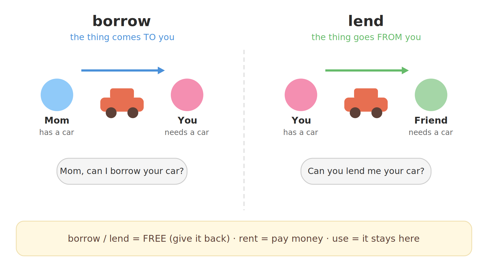

# 2. Vocabulary — Borrow, Lend, Rent, Use (Study Notes)

> Teacher: Ronnie (English with Ronnie / engVid)
> Source: video "002. 2. Vocabulary - Borrow, Lend, Rent, Use"
> The notes follow the themes of the lesson, in order.

**How to read these notes:** phonetics in **[ ]** are British IPA. **Bold words** are the words this lesson teaches — each has a simple English explanation, and the important topic words also have a small Chinese meaning in parentheses at the end.

---

## 1. The famous quote

Ronnie starts with a famous quote from Shakespeare's play *Hamlet*: **"Neither a borrower nor a lender be."** It means: do not lend people things, and do not borrow things — especially money. If you know who said it, give yourself a point!

**Lesson words:**
- **borrower** [ˈbɒrəʊə] — a person who borrows（借入者）
- **lender** [ˈlendə] — a person who lends（出借者）
- **quote** [kwəʊt] — words from a book, film or famous person（引语）
- **neither...nor** [ˈnaɪðə ... nɔː] — not one and not the other; it joins two negative ideas（两者都不）
- **double negative** [ˌdʌbl ˈneɡətɪv] — two negative words used together（双重否定）

> Grammar note: in modern English, one negative word is enough ("I don't have a car"). "Neither...nor" is the old-fashioned pair: "neither a borrower **nor** a lender be". In Old English the word was "or"; today we say "nor".

## 2. Borrow — the thing comes TO you

The easiest way to remember the four verbs is to ask: **who is doing the action?** When you **borrow**, you need something and you do not have it, so you ask someone for it. Example: "I do not have a car. Sometimes I need to borrow my mother's car." → "Mom, can I please borrow your car?"

*Borrow: the thing comes to you. Lend: the thing goes from you.*

**Lesson words:**
- **borrow** [ˈbɒrəʊ] — to take something from someone for a short time and then give it back; you do not pay（借入）
- **in need** [ɪn niːd] — needing something; not having enough（有需要的）
- **public transportation** [ˌpʌblɪk ˌtrænspɔːˈteɪʃn] — buses, trains and the subway that everyone can use（公共交通）

## 3. Lend — the thing goes FROM you

**Lend** is the opposite of borrow. When you lend, you HAVE the thing and you GIVE it to someone in need. Example: "If I had a car and you didn't have a car, you would ask me if you could borrow my car. I would lend you my car."

Two questions, same situation:
- The person in need asks: **"Can I borrow your car?"**
- The owner answers: **"Can you lend me your car?"** — hmm, wait. Let me get this right. Ronnie says: "You would ask me, 'Can you lend me your car?'" — the person in need asks the owner "Can you lend me your car?" — yes, that's what the transcript says: "you would ask me.you.人。" + "me.your.car" → "Can you lend me your car?" — the asker is the person who needs the car. So:
  - The person in need asks the owner: **"Can you lend me your car?"** (asking the owner to lend)
  - The owner's question to test yourself: **"Can I borrow your car?"** — hmm no. Let me re-read the transcript: "So this is: I have a car. You want my car. You would ask me, 'Can you lend me your car?' In the case of 'borrow', the question would be, 'Can I borrow your car?'"

So: with LEND, the sentence is "Can you lend me your car?" (you ask me to lend); with BORROW, the sentence is "Can I borrow your car?" (I ask to borrow). Both are asked by the person in need — the difference is which verb is in the question. OK so my bullet points should be:

- With **lend**, the question is: **"Can you lend me your car?"** (the speaker asks the owner to lend)
- With **borrow**, the question is: **"Can I borrow your car?"** (the speaker asks to borrow)

**Lesson words:**
- **lend** [lend] — to give something to someone for a short time; they will give it back（借出）
- **return** [rɪˈtɜːn] — to give something back to its owner（归还）

## 4. Rent — like borrowing, but you pay

Another way to think of borrowing: it is almost the same as **renting**. The basis of both is that you get something now. The difference is money: when you borrow, it is **free** — you do not have to pay. But when you rent, you have to give the people money, and they usually want lots and lots of it. Common things people rent: DVDs (from a video store) and cars.

**Lesson words:**
- **rent** [rent] — to pay money to use something for a short time（租用）
- **video store** [ˈvɪdiəʊ stɔː] — a shop where you rent films（音像店）
- **free** [friː] — costing no money（免费的）

## 5. Where you can borrow: the library

A **library** is a place where you can borrow things for free — DVDs and books. You do not pay the library money. You just give them your card and you promise to return them.

**Lesson words:**
- **library** [ˈlaɪbrəri] — a place where you can borrow books and films for free（图书馆）
- **card** [kɑːd] — here, your library card — the card that lets you borrow things（借书证）
- **promise** [ˈprɒmɪs] — to say that you will certainly do something（承诺）

## 6. Use — it stays here

**Use** versus **borrow**: there is not a lot of difference. The only difference is that if you borrow something, you use it and you have to return it. Usually when you use something, the idea that we will return it is there, but usually we don't. Tests from the lesson:

- **Pen** — "Can I use your pen?" ✔ (the pen stays on the table; maybe Ronnie will steal it!)
- **Car** — you would never say "Can I use your car?" — you must say **borrow** (you take it away and bring it back).
- **Toilet** — Ronnie's friend said "Can I borrow your toilet?" Wrong! A toilet stays in the place and you use it right now — you say **"use it"**. "Borrow" means you take it home, play with it for a bit, and then return it.

**Lesson words:**
- **use** [juːz] — to do something with a thing for a purpose（使用）
- **item** [ˈaɪtəm] — one single object（物品）
- **for a bit** [fər ə bɪt] — for a short time（一会儿）

## 7. The four verbs at a glance

| Verb | Who has it? | Money? | Give it back? | Example |
|---|---|---|---|---|
| **borrow**（借入） | someone else | no — free | yes | Can I borrow your car? |
| **lend**（借出） | you | no — free | yes | Can you lend me your car? |
| **rent**（租用） | a shop or company | YES — you pay | yes | I rented a car for the weekend. |
| **use**（使用） | it stays in the place | no | usually NO | Can I use your pen? |

Memory trick from the lesson: **borrow = no money · rent = lots of money · use = it stays here.** And the whole lesson in one question: **who is doing the action?**

## 8. Sentence analysis: find the trunk, then the adverbs

Native speakers do not read word by word. They grab the **subject + verb** (the trunk) first, then hang the modifiers on it. Here is the method, practiced on real sentences from the lesson:

1. Find **S + V** — the smallest complete idea.
2. Find the **adverbs** — and ask what each one changes: the verb? an adjective? the whole sentence?
3. Find the **clauses** and **prepositional phrases** — each one answers a question (when? where? which one? how?).

### 8.1 "**Today** I'm going to talk about something that is **very** **easily** confused when we speak English."
- **Trunk:** **I** (subject) + **'m going to talk** (verb)
- **Today** [təˈdeɪ] — time adverb → modifies the whole clause (answers WHEN: on this day).
- **very** [ˈveri] — degree adverb → modifies "confused" (an adjective/participle here).
- **easily** [ˈiːzəli] — manner adverb → modifies **confused**: "in an easy way" — English speakers do this without thinking.
- Modifiers: "that is very easily confused" — relative clause → modifies **something**; "when we speak English" — time clause → modifies the main idea.

### 8.2 "For example, I do not have a car, so **sometimes** I need to borrow my mother's car."
- **Trunk 1:** **I** + **do not have**; **Trunk 2:** **I** + **need**
- **sometimes** [ˈsʌmtaɪmz] — frequency adverb → modifies **need** (answers HOW OFTEN).
- Modifiers: "For example" — a discourse marker (it introduces an example, no grammar job); "so" — result conjunction; "my mother's car" — object.

### 8.3 "**Usually** when you use something, the idea that we will return it is **there**, but **usually** we don't."
- **Trunk 1:** **the idea** + **is**; **Trunk 2:** **we** + **do** (don't)
- **Usually** [ˈjuːʒuəli] (twice) — frequency adverbs → modify **is** and **don't** ("in most cases").
- **there** [ðeə] — place adverb → modifies **is**: the idea exists.
- Modifiers: "when you use something" — time clause; "that we will return it" — relative clause → modifies **idea** (WHICH idea).

### 8.4 "If I use your pen, I'm going to write and **maybe** steal it."
- **Trunk:** **I** + **'m going to write** / **(I will) steal**
- **maybe** [ˈmeɪbi] — sentence adverb → modifies the whole clause "steal it" ("perhaps").
- Modifiers: "If I use your pen" — conditional clause; "it" — object of "steal".

### 8.5 "But you would **never** let me use your car."
- **Trunk:** **you** (subject) + **would let** (verb)
- **never** [ˈnevə] — frequency adverb → modifies **would let** ("at no time").
- Modifier: "use your car" — bare infinitive phrase after "let" (pattern: let somebody **do** something).

### 8.6 "My friend **recently** came to my house and said, 'Can I borrow your toilet?'"
- **Trunk:** **My friend** (subject) + **came** / **said** (verbs)
- **recently** [ˈriːsntli] — time adverb → modifies **came** (a short time ago).
- Modifiers: "to my house" — prepositional phrase → modifies **came** (WHERE); "'Can I borrow your toilet?'" — the object of "said".

### 8.7 "This **basically** means don't lend people things and don't borrow things, **especially** money."
- **Trunk:** **This** (subject) + **means** (verb)
- **basically** [ˈbeɪsɪkli] — sentence adverb → modifies **means**: "in simple words".
- **especially** [ɪˈspeʃəli] — focusing adverb → modifies **money**: it points to the most important example.
- Modifiers: "don't lend people things" and "don't borrow things" — two imperative clauses; together they are the object of "means".

### 8.8 "'Neither' is when we have a double negative; it **just** means 'no'."
- **Trunk 1:** **Neither** + **is**; **Trunk 2:** **it** + **means**
- **just** [dʒʌst] — limiting adverb → modifies **means**: "simply / only".
- Modifier: "when we have a double negative" — noun clause; it is the predicative after "is".

### 8.9 "The easiest way to remember this is who is doing the action."
- **Trunk:** **The easiest way** (subject) + **is** (verb)
- No adverb in this sentence — the modifiers are the infinitive "to remember this" (→ modifies **way**) and the noun clause "who is doing the action" (the predicative).
- This is the key question of the whole lesson: **who is doing the action?**

### 8.10 "**Usually** 'borrow' — you take it home, play with it for a bit, and **then** return it."
- **Trunk:** **you** (subject) + **take** / **play** / **return** (verbs)
- **Usually** — frequency adverb → modifies the whole sentence ("in most cases").
- **then** [ðen] — sequence adverb → modifies **return**: after that, in the end.
- Modifiers: "home" — adverb → modifies **take** (WHERE); "for a bit" — prepositional phrase → modifies **play** (HOW LONG).
