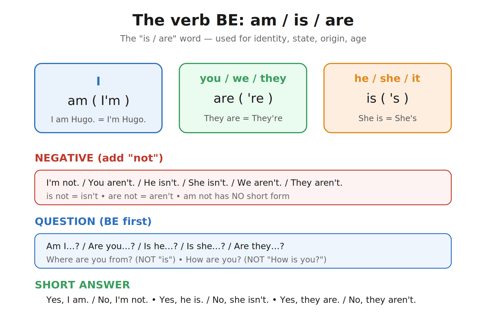
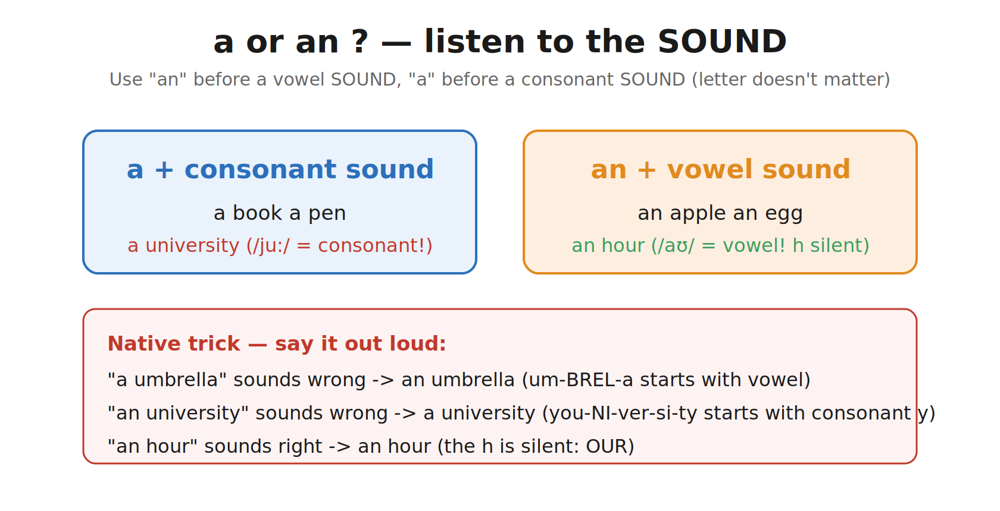
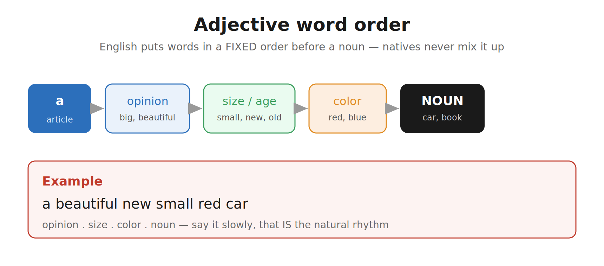
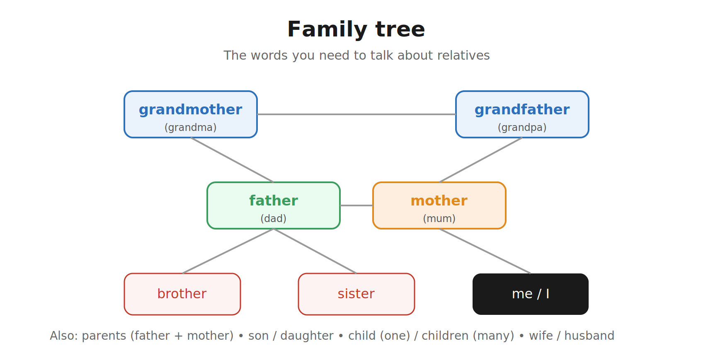
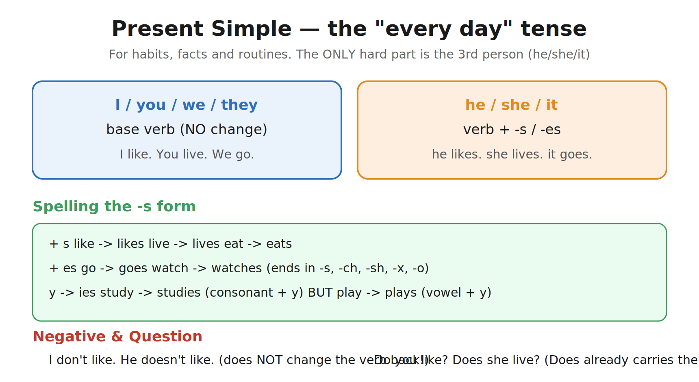
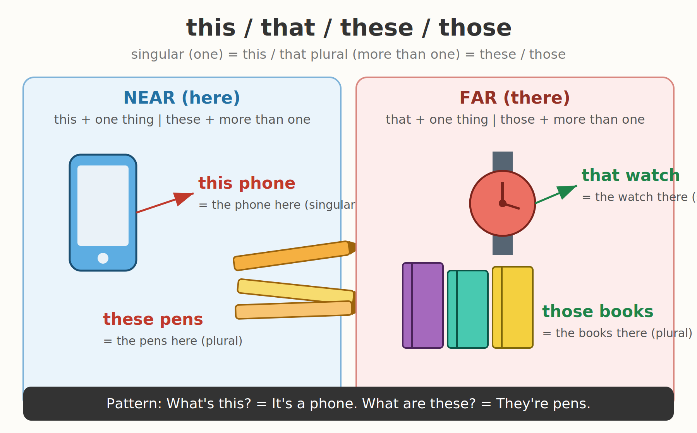
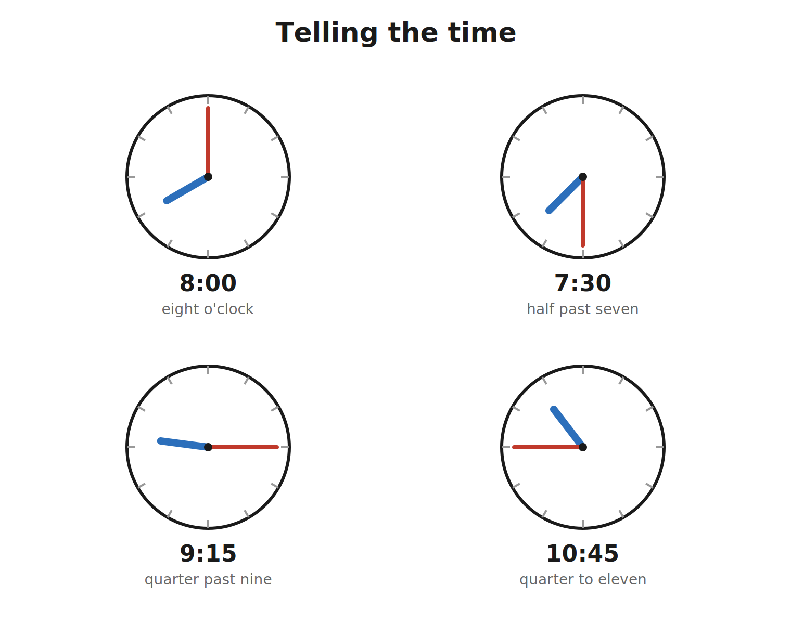
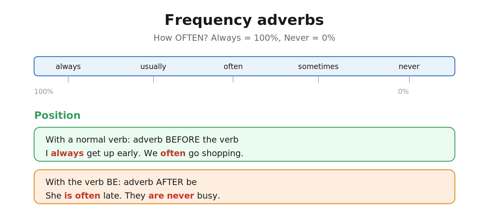
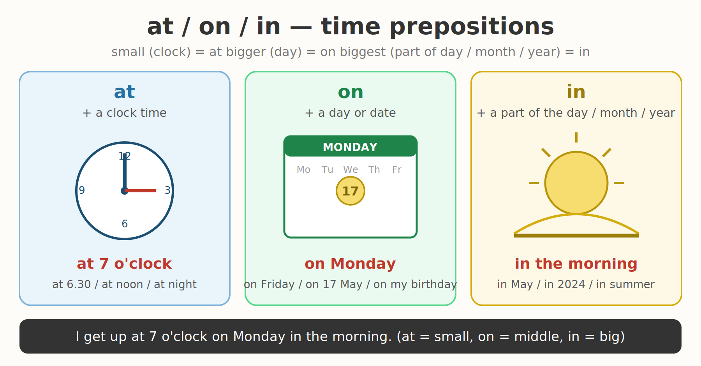

# Face2Face Starter Units 1–5 语法详解

> **适用**：Units 1–5（New friends → Day-to-day life），A1 起步级
> **写法**：母语者视角 + 大白话 + 场景例句 + 配图
> **怎么读**：每个语法点先看「它到底是什么」，再看「母语者怎么用」，最后看「场景」和「常见错误」。配图在每节末尾。

---

## 写在前面：母语者是怎么看语法的

英国人或美国人学母语时，**从来不背语法术语**。他们脑子里只有三件事：

1. **这个词放在句子哪个位置**（词序）；
2. **这个动词要不要变样子**（尤其是 he/she/it 后面）；
3. **这句话是「陈述 / 否定 / 提问」哪一种**。

所以这本详解不让你背规则表，而是告诉你：**一个母语者开口前脑子里想的是什么**。你照着这个思路练，说的就是「人话」，而不是考试体。

下面所有例子，左边是英文，右边是直译，括号里是「母语者为什么这么说」。

---

## 1. be 动词（am / is / are）—— Unit 1 的核心

### 它到底是什么？
中文里「是」一个字走天下：我是、你是、他是。英文把「是」拆成了**三张脸**，因为你说的「谁」不同，动词就不同：

| 你指的是 | 用哪个 | 缩写 |
|---|---|---|
| 我 I | **am** | I'm |
| 你 / 我们 / 他们 you / we / they | **are** | you're / we're / they're |
| 他 / 她 / 它 he / she / it | **is** | he's / she's / it's |

> 💡 **母语者视角**：母语者根本不想「am 还是 is」，他们脱口而出靠的是**语感**——说 "I" 后面永远接 'm，说 "He" 后面永远接 's。你练到这个程度，就对了。

### 否定：加 not
- I **'m not**. / You **aren't**. / He **isn't**. / She **isn't**. / They **aren't**.
- 注意：**am not 没有缩写**（不说 I'mn't，从来没人这么说）。

### 疑问：把 be 提到最前面
- **Are** you from China?（你来自中国吗？）
- **Is** she a teacher?（她是老师吗？）

### 简略回答（母语者最爱用，绝不说完整句）
- Are you English? — **Yes, I am.** / **No, I'm not.**
- Is he Chinese? — **Yes, he is.** / **No, he isn't.**

### 场景 1：自我介绍
- **I'm** Hugo.（我是雨果。）→ 母语者介绍自己永远用 I'm，不会说 "I am Hugo" 除非刻意强调。

### 场景 2：说国籍 / 来历
- **I'm** Chinese. / **She's** from Japan.（她来自日本。）
- ⚠️ **最易错**：问别人哪国人说 **Where are you from?**（你从哪儿来？），**不是** "Where is you from?"——因为 you 配 are。

### 场景 3：描述东西 / 人
- It **'s** a book.（这是本书。）/ She **'s** beautiful.（她很漂亮。）

---

## 2. 人称代词 & 物主形容词

### 主语（谁做动作）
| 中文 | 英文 |
|---|---|
| 我 / 你 / 他 / 她 / 它 | I / you / he / she / it |
| 我们 / 你们 / 他们 | we / you / they |

### 物主（谁的）
| 中文 | 英文 | 例子 |
|---|---|---|
| 我的 / 你的 / 他的 / 她的 | my / your / his / her | my name, your book |
| 我们的 / 你们的 / 他们的 | our / your / their | our teacher |

> 💡 **母语者视角**：母语者说话时**经常把代词吞掉**（口语里 "Gotta go" = I've got to go，I 都快没了）。但在正式写法、和外国人交流时，**代词一个都不能少**——英文不像中文能靠语境省主语，英文句子必须有主语。

### 场景
- **My** name is Lian.（我的名字是莲。）→ my 后必须跟名词，不能单独用。
- **This is his** pen.（这是他的笔。）→ his 既是「他的」也能当名词用（This is his = 这是他的）。

---

## 3. a / an（一个……）

### 规则一句话
看**发音**，不看字母：
- 后面单词**以元音发音开头** → **an**（an apple, an egg, an umbrella）
- 后面单词**以辅音发音开头** → **a**（a book, a pen, a university）

> 💡 **母语者视角**：母语者判断 a/an 靠**舌头**，不靠眼睛。听到下一个词开头是元音滑音就用 an，否则用 a。两个经典陷阱：
> - **a university**（university 开头是 /j/ 辅音，所以用 a，不是 an）
> - **an hour**（hour 的 h 不发音，开头是 /aʊ/ 元音，所以用 an）

---

## 4. 名词复数（一个变多个）

### 规则：大多加 -s
pen → **pens**，book → **books**，key → **keys**，bag → **bags**

### 几个小变化（Unit 1 够用）
- 以 -s / -sh / -ch / -x / -o 结尾 → 加 -es：bus → **buses**，watch → **watches**
- 以「辅音 + y」结尾 → y 变 i 加 -es：city → **cities**

> ⚠️ **母语者视角**：口语里单复数经常靠**冠词和动词**来判断，不靠词尾听清。比如 "I have two book" 母语者一听就懂，但写作必须写 books。初学先保证写作正确。

---

## 5. 数字 0–12 与 13–100

### 0–12（必须背熟，像母语者一样脱口）
zero, one, two, three, four, five, six, seven, eight, nine, ten, eleven, twelve

### 13–100
- 13–19 以 **-teen** 结尾（重音在**后面**：thir**teen**）
- 20,30…90 以 **-ty** 结尾（重音在**前面**：**twen**ty）
- ⚠️ 母语者都能听出 thirteen（13）和 thirty（30）的区别，靠的就是重音位置。你读错重音，他们要愣一下。

### 场景：报电话号码
母语者读号码是**一个一个数字**念，0 读 "oh" 不读 zero：07644 → oh seven six four four。

---

## 6. 职业 / 称谓 / 国籍 —— Unit 2

### 职业问答
- **What's your job?**（你是做什么的？）→ **I'm a teacher / a doctor / a student.**
- 注意：职业前加 **a**：a teacher，不是 "I'm teacher"。

### 称谓（写在姓氏前）
| 称谓 | 用法 |
|---|---|
| **Mr** /ˈmɪstə/ | 先生（已婚未婚皆可） |
| **Mrs** /ˈmɪsɪz/ | 太太（已婚） |
| **Ms** /mɪz/ | 女士（不透露婚否，现代最常用） |
| **Miss** /mɪs/ | 小姐（未婚/年轻） |

### 国籍形容词（首字母必须大写！）
Chinese, British, American, Japanese, French, Italian, Spanish, Australian, German, Brazilian, Russian, Turkish
- ⚠️ 母语者写 "I'm chinese" 会被扣分——**国籍形容词永远大写**，和中文习惯相反。

### 场景
- "Nice to meet you, **Ms** Horton."（霍顿女士，很高兴认识你。）
- "I'm **Australian**."（我是澳大利亚人。）

---

## 7. 形容词与词序 —— Unit 3

### 中文 vs 英文的词序
中文说「一辆漂亮的新红色小车」，英文**顺序固定**为：
**a + 观点 + 大小/年龄 + 颜色 + 名词**

> 💡 **母语者视角**：母语者形容东西时，顺序是**肌肉记忆**。如果你说 "a red big car"，母语者会觉得「哪儿不对劲」，但能懂。正确是 **a big red car**（观点 big 在前，颜色 red 在后）。

### very（非常）
very 放在形容词前加强语气：**very big / very beautiful / very expensive**。

---

## 8. 家庭 —— Unit 3

核心词：mother（妈）, father（爸）, parents（父母）, brother（兄弟）, sister（姐妹）, son（儿子）, daughter（女儿）, child（孩子·单）/ children（孩子·复）, grandmother（祖母）, grandfather（祖父）, wife（妻）, husband（丈夫）。

> 💡 **母语者视角**：口语里多用 **mum / dad / grandma / grandpa**。说 "my mum" 比 "my mother" 自然一百倍。child 的复数是 **children**（不是 childs），这是母语者从小用错的少数点之一，但写作必须对。

---

## 9. 食物饮料 + like / love / eat / drink + a lot of —— Unit 3

### 喜欢的食物
- I **like** pizza. / I **love** chocolate.（love 比 like 程度深）
- I **don't like** fish.（我不喜欢鱼。）→ 否定加 don't

### 吃喝
- I **eat** rice. / She **drinks** coffee.（第三人称 drink 加 s）

### a lot of（许多）
- I drink **a lot of** coffee.（我喝很多咖啡。）
- 不分可数不可数，a lot of 通吃，母语者超爱用。

---

## 10. 一般现在时（最核心的时态）—— Unit 3–5

### 它表达什么？
**习惯、事实、日常**——「我每天……」「他总是……」「猫爱吃鱼」。

### 动词变形（唯一的难点：三单）
| 主语 | 动词 |
|---|---|
| I / you / we / they | **原形**（不变） |
| he / she / it | **原形 + s / es** |

- I **like**. / He **likes**.
- She **goes**（以 o 结尾加 es）. / He **watches**（ch 结尾加 es）. / She **studies**（辅音+y 变 ies）.

> 💡 **母语者视角**：母语者说三单加 s 是**自动的**，就像中文「他吃」的「吃」不会变，但英文必须加。这是中文母语者**最容易忘**的一点——每次说 he/she/it 后面的动词，先想「加 s 了吗？」

### 否定与疑问（用 do / does 帮忙）
- 否定：**I don't like.** / **He doesn't like.**（doesn't 已经带了三单，后面动词**回原形**！）
- 疑问：**Do you like?** / **Does she live?**（Does 已经带了 s，后面动词**回原形**！）

### 场景 1：日常习惯
- I **get up** at seven.（我七点起床。）
- My sister **studies** English every day.（我妹每天学英语。）

### 场景 2：客观事实
- The sun **rises** in the east.（太阳从东边升起。）

---

## 11. like + -ing（爱好）—— Unit 4

### 表达「喜欢做……」
在动词后加 **-ing**：
- I like **watching** TV.（我喜欢看电视。）
- She likes **reading** books.（她喜欢读书。）
- We like **playing** tennis.

> 💡 **母语者视角**：说爱好时，母语者几乎**永远**用 like + -ing，而不是 like + to do（虽然语法也对，但 -ing 更自然、更口语）。初学直接记 -ing 版本最稳。

---

## 12. have / live / work / study —— Unit 4

- I **have** a sister.（我有个妹妹。）/ He **has** a cat.（他有只猫。）→ have 的三单是 **has**
- They **live** in China.（他们住在中国。）/ She **lives** in London.
- We **work** at a school. / He **works** in an office.
- I **study** English. / Tom **studies** maths.

---

## 13. 指示代词 this / that / these / those —— Unit 4

| | 近（这） | 远（那） |
|---|---|---|
| 单数 | **this**（这个） | **that**（那个） |
| 复数 | **these**（这些） | **those**（那些） |

> 💡 **母语者视角**：母语者指东西时，**手一伸**就自然选 this/these（近），**手一指远处**就选 that/those（远）。这是身体语言带出来的语法。

### 场景
- **This** is my book.（这是我（手里）的书。）
- **That** is your bag over there.（那边那个是你包。）
- **These** are my pens. / **Those** are your keys.

---

## 14. 星期与时间词 —— Unit 4

### 星期（首字母大写，从 Monday 到 Sunday）
Monday, Tuesday, Wednesday, Thursday, Friday, Saturday, Sunday
- ⚠️ 母语者说 "on Monday"（加 on），不会说 "Monday I go"。

### 时间词
morning（早）, afternoon（午）, evening（晚）, night（夜）, today（今天）, tomorrow（明天）, weekend（周末）

---

## 15. 时间表达 —— Unit 5

### 整点、半、一刻
- 8:00 → **eight o'clock**
- 7:30 → **half past seven**（七点半）
- 9:15 → **quarter past nine**（九点一刻）
- 10:45 → **quarter to eleven**（差一刻十一点 = 十点四十五）

> 💡 **母语者视角**：母语者说时间有**两种说法**混着用——"seven thirty" 和 "half past seven" 都对，但 "half past" 更有英式味道。10:45 母语者更常说 "quarter to eleven" 而不是 "ten forty-five"。

---

## 16. 日常作息动词 —— Unit 5

get up（起床）, have a shower（洗澡）, have breakfast / lunch / dinner（吃早/午/晚餐）, go to work / school（去上班/上学）, go home（回家）, go to bed（睡觉）。

- 全用一般现在时：**He gets up at seven. She has breakfast at eight.**

---

## 17. 频率副词 —— Unit 5

always（总是）> usually（通常）> often（经常）> sometimes（有时）> never（从不）

### 位置（母语者的隐藏规则）
- **普通动词前**：I **always** get up early.
- **be 动词后**：She **is often** late. / They **are never** busy.

> 💡 **母语者视角**：位置错了母语者也能懂，但会变「不地道」。记住一句口诀：**实义动词前，be 动词后**。

---

## 18. 时间介词 on / in / at —— Unit 5

| 介词 | 用在 | 例子 |
|---|---|---|
| **on** | 星期、具体某天 | on Monday, on Sunday |
| **in** | 早中晚、月、年 | in the morning, in 2010 |
| **at** | 钟点、夜晚、周末 | at eight, at night, at the weekend |

> 💡 **母语者视角**：这三个介词母语者靠**搭配语感**选，不背规则。一个速记：**on 接「块」(某天)，in 接「段」(时段)，at 接「点」(时刻)**。

---

## 19. every（每……）

- **every day**（每天）/ **every week**（每周）/ **every morning**（每天早上）
- 常与频率副词、一般现在时搭档：I go shopping **every Sunday**.

---

## 附录：Units 1–5 语法自查表

| 我会了吗 | 语法点 | 一句话检验 |
|---|---|---|
| ☐ | be 动词 | 能脱口 I'm / he's / they're，疑问把 be 提前 |
| ☐ | a / an | 听到元音发音就用 an（an hour ✓） |
| ☐ | 名词复数 | 规则加 s，watch→watches |
| ☐ | 三单 -s | He likes / She goes / Tom studies 不忘 s |
| ☐ | do/does | 否定疑问用 don't/doesn't，后面动词回原形 |
| ☐ | like + -ing | 爱好一律 like watching/reading |
| ☐ | this/that | 近 this/these，远 that/those |
| ☐ | 时间 | half past / quarter past/to 会读 |
| ☐ | 频率副词 | always 在动词前、be 后 |
| ☐ | on/in/at | on 天 / in 段 / at 点 |

> 建议：把这份自查表和「课后习题」配合使用——习题做错哪题，回来看对应的语法点，再重做。三个文件（学习笔记 / 课后习题 / 本语法详解）放在同一课目录下，互相跳转复习最高效。
