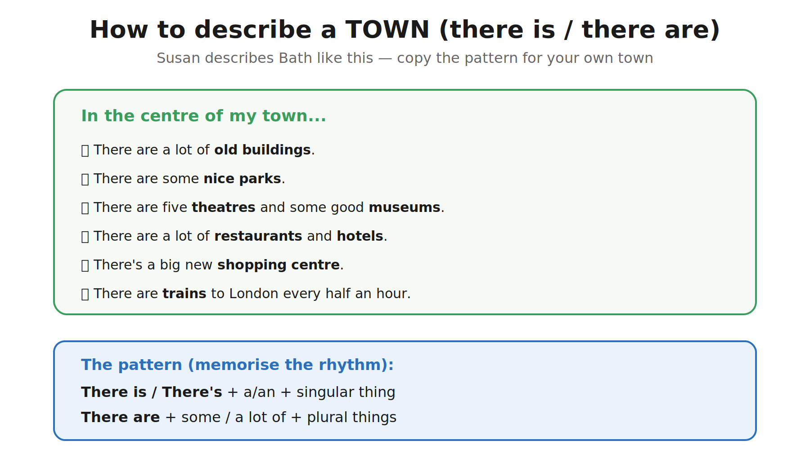
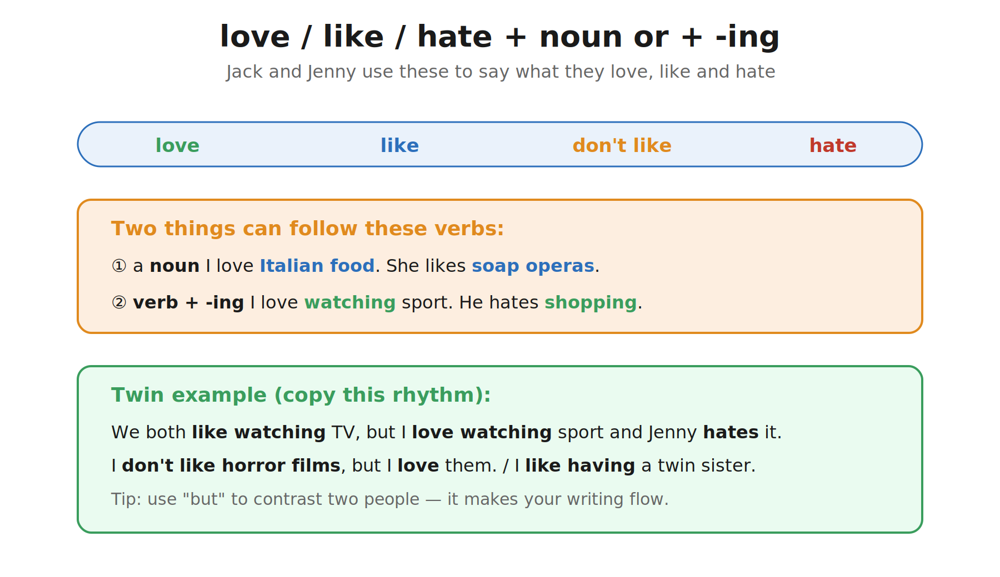
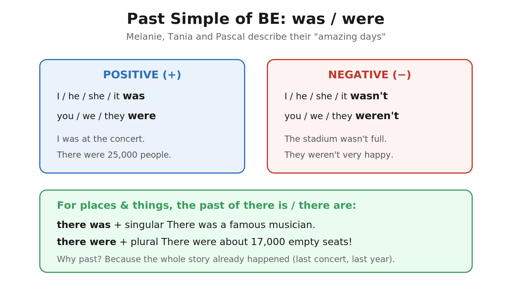
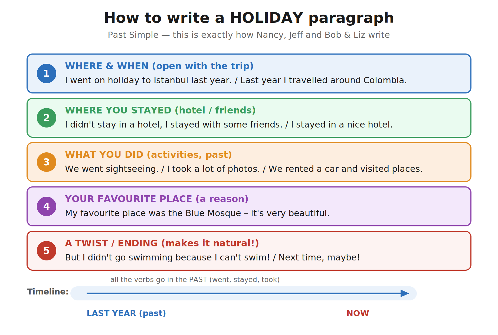
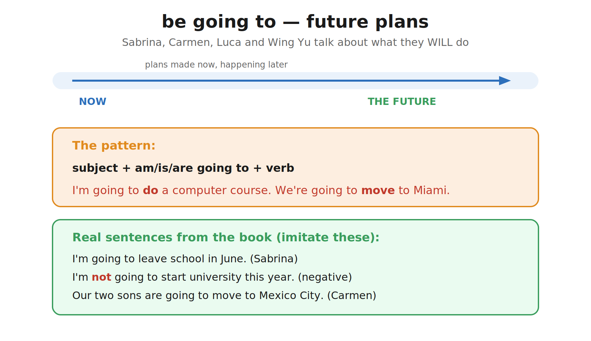

# Face2Face Starter Units 5–10 · 阅读与写作教程

> **适用**：学生用书 Unit 5 → 结尾（Day-to-day life → My future），对应你从第五课读到结尾的内容
> **目标**：把书里**有价值的范文拆开学**——既能看懂、又能**照着写自己的文章**，还讲清**语法为什么这么用**
> **规范**：沿用之前的写法（音标 [ ] + 粗词 + 英文释义优先/中文括注 + 句子主干 + 场景 + 配图）
> **怎么用**：每篇分 6 步——📖原文 → ✍️结构拆解 → 📝模仿模板 → 🔤词汇 → 📐语法为什么 → 🔍句子主干。先读原文，再照模板写自己的版本。

---

## 写在前面：母语者是怎么读、怎么写的

母语者写一段话，脑子里只有三件事：

1. **我要讲哪几件事？**（先定 4–5 个要点，不写废话）
2. **按什么顺序讲？**（时间顺序 / 空间顺序 / 喜好对比）
3. **怎么让文章「活」？**（结尾加一句反转、评价或个人感受）

所以这本教程教你两件事：**读懂它的骨架** + **套骨架写你的**。下面每篇范文都拆到「句子层面」，你照着模仿模板填自己的内容，就是一篇地道英文。

---
---

# 🌅 Unit 5 · Day-to-day life（日常作息）

## 📖 文章：Carol's routine（卡罗尔的一天）

> Carol and her brother Tom live in Manchester. Carol **gets up** at seven, but she **doesn't like** mornings! She **has** breakfast at about eight and she **leaves** home at nine. She **works** in a mobile phone shop and she **starts** work at nine thirty. She **has** lunch at one in a café near the shop. She **finishes** work at five thirty and gets home. After dinner, she **goes out** with friends. She **goes to bed** at midnight and sleeps for about seven hours.

## ✍️ 写作结构拆解
- **开头**：谁 + 住哪（Carol and her brother live in Manchester）
- **主体**：按**时间顺序**写一整天（gets up → breakfast → leaves → work → lunch → finishes → goes out → bed）
- **调味**：插一句个人感受（but she doesn't like mornings!）——让文章不呆板

## 📝 模仿模板（写你的一天）
```
My name is ____ and I live in ____.
I ____ at ____ , and I ____ breakfast at ____ .
Then I ____ to work / school at ____ .
I have lunch at ____ . In the afternoon I ____ .
In the evening I ____ . I go to bed at ____ .
```

## 🔤 词汇
| 单词 | 音标 | 释义 |
|---|---|---|
| **get up** | [ɡet ʌp] | 起床（not "wake up"——get up = 起来下床） |
| **leave home** | [liːv həʊm] | 离家（leave 是「离开」，left 是过去式） |
| **work** | [wɜːk] | 工作 / 上班（名词动词同形） |
| **finish** | [ˈfɪnɪʃ] | 结束（finish work 下班） |
| **go out** | [ɡəʊ aʊt] | 外出（社交、玩） |
| **go to bed** | [ɡəʊ tə bed] | 上床睡觉 |

## 📐 语法：为什么这么用？
- **一般现在时**（gets up / has / works）：因为这是**每天的固定习惯**——英语用现在时讲「常态、习惯」，不是「正在」。
- **三单加 -s**（Carol get**s** / work**s** / leave**s**）：主语是 she（单数第三人称），动词必须加 -s。这是中文没有的，最容易忘。
- **否定 doesn't + 动词原形**：she **doesn't like**（不是 doesn't likes）——does 已经「承担」了 s，动词还原。

## 🔍 句子主干
> **She / has / lunch** at one in a café near the shop.
> 主语 She ＋ 谓语 has（吃）＋ 宾语 lunch；`at one`、`in a café`、`near the shop` 都是**状语**，说明时间地点。

---
---

# 🏛️ Unit 6 · Towns and cities（城镇描写）★

## 📖 文章：Susan's Bath（苏珊眼中的巴斯）

> I **live in Bath**, a city in England. It's a very beautiful place. **There are a lot of** old buildings in the centre and **there are some** very nice parks. Bath **is famous for** its hot springs, and you can swim in the hot water at the Thermae Bath Spa. I go there every Sunday – it's great! In the centre of Bath **there are** five theatres and some very good museums, including the Roman Baths and the Jane Austen Centre, about the famous English writer. **There are also a lot of** good restaurants and hotels, and **there's** a big new shopping centre called SouthGate. **There are** trains to London every half an hour, and **there's** an airport in Bristol, only 15 miles away. I think Bath is a great place to live.



## ✍️ 写作结构拆解（描述一个地方的万能骨架）
1. **开场**：I live in + 地名，a city in + 国家
2. **总评价**：It's a very beautiful place.
3. **中心区**：There are a lot of / some + 名词（建筑、公园、剧院、博物馆）
4. **特色**：… is famous for …（以…闻名）
5. **便利设施**：There are trains / There's an airport …
6. **收尾**：I think … is a great place to live.

## 📝 模仿模板（描述你的城市）
```
I live in ____ , a city in ____ . It's a very ____ place.
There are a lot of ____ in the centre and there are some ____ .
My city is famous for ____ .
There are ____ and there's a big ____ .
There are trains / buses to ____ every ____ .
I think ____ is a great place to live.
```

## 🔤 词汇
| 单词 | 音标 | 释义 |
|---|---|---|
| **building** | [ˈbɪldɪŋ] | 建筑物（复数 buildings） |
| **centre** | [ˈsentə] | 中心（美式 center） |
| **be famous for** | [bi ˈfeɪməs fə] | 以…闻名（be famous for its hot springs） |
| **hot springs** | [hɒt sprɪŋz] | 温泉 |
| **museum** | [mjuˈziːəm] | 博物馆 |
| **shopping centre** | [ˈʃɒpɪŋ ˈsentə] | 购物中心 |

## 📐 语法：为什么这么用？
- **there is / there are**（有）：描述「某个地方**存在**什么」专用。中文说「有个公园」，英文必须说 **There is** a park——不能直接说 "A park is"。
- **单复数搭配**：**There is** + 单数（a shopping centre）／**There are** + 复数（five theatres）。
- **a lot of / some**：a lot of = 许多（可数不可数都行），some = 一些，都是「数量词」放在名词前。
- **用现在时**：因为介绍的是城镇「长期存在的事实」，不是某一次的事。

## 🔍 句子主干
> **There are** a lot of old buildings **in the centre**.
> There are 是「存在有」；`in the centre` 是**地点状语**。
> **Bath / is / famous** for its hot springs.（主语 Bath ＋ 谓语 is famous）

---
---

# 👯 Unit 7 · Love it, like it, hate it!（喜好对比）★

## 📖 文章：Jack and Jenny（双胞胎的不同喜好）

**Jack 版：**
> Jenny and I are **twins**, but our friends tell we're very **different**. We never go to concerts together because I **like** rock music and Jenny **loves** classical music. We both **like watching** TV, but I **love watching** sport and Jenny **hates** it. And Jenny **doesn't like** horror films, but I **love** them. But I **like having** a twin sister. I don't see her every week, but she phones every weekend.

**Jenny 版：**
> Jack's my twin brother, but we don't like the same things. We don't usually eat out together because I **like** Chinese food and Jack **loves** Italian food. We both **like watching** TV, but I **love** soap operas and he **hates** them. And I **don't like flying**, but Jack **loves** it. Yes, we're very different, but I **like having** a twin brother and I always phone him at the weekend.



## ✍️ 写作结构拆解（对比两人喜好的写法）
1. **开场**：交代关系 + 点明「我们不一样」（We're twins, but we're different.）
2. **逐项对比**：用 **but** 连接（I like A, but he likes B）——这是对比文的核心胶水
3. **共同点**：We **both** like …（我们俩都喜欢…）——先说同，再说异，读起来有节奏
4. **收尾**：But I like having a twin …（转折回正面，升华感情）

## 📝 模仿模板（写你和朋友/家人的对比）
```
____ and I are ____ , but we're very different.
I like ____ but ____ loves ____ .
We both like ____ , but I love ____ and ____ hates ____ .
____ doesn't like ____ , but I love it / them.
But I like being / having ____ .
```

## 🔤 词汇
| 单词 | 音标 | 释义 |
|---|---|---|
| **twins** | [twɪnz] | 双胞胎（twin 双胞胎之一） |
| **different** | [ˈdɪfrənt] | 不同的（the same 的反义） |
| **rock music** | [rɒk ˈmjuːzɪk] | 摇滚乐 |
| **classical music** | [ˈklæsɪkl ˈmjuːzɪk] | 古典乐 |
| **horror films** | [ˈhɒrə fɪlmz] | 恐怖片 |
| **soap operas** | [səʊp ˈɒprəz] | 肥皂剧（连续剧） |

## 📐 语法：为什么这么用？
- **love / like / hate + 名词 或 + 动词-ing**：这四个词后面跟「喜欢的**东西**」或「喜欢做的**活动**」。跟活动时用 **-ing**（love watching、like having），这是英语固定搭配，记住「like doing」最稳。
- **为什么用 -ing 不用 to do？**：表示「享受这件事本身」时母语者更常说 -ing；like to do 偏向「具体某次去做」。初学一律用 -ing 最自然。
- **both**（两个都）放在动词前：We **both like** …；**but** 表对比，是这类文章的连接词灵魂。

## 🔍 句子主干
> **We both / like / watching TV**, but **I / love / watching sport**.
> 主语 We ＋ 谓语 like ＋ 宾语 watching TV；`both` 是**状语**修饰 like，说明「两个人都」。
> `but` 连接两个完整句，后半句 I / love / watching sport 又是「主谓宾」。

---
---

# 🎵 Unit 8 · Days to remember（难忘的日子）

## 📖 文章：Melanie's amazing day（梅拉妮的难忘一天）

> I **was** at the Beatles' last concert. It **was** in San Francisco in 1966. **There were** 25,000 people at the concert, but the stadium **wasn't** full – **there were** about 17,000 empty seats! The concert **wasn't** very long, only 33 minutes, but I **was** very happy to be there. I **was** only sixteen at the time.



## ✍️ 写作结构拆解（写「难忘的一天」）
1. **开场**：I was at + 地点/事件（I was at the concert.）
2. **时间地点**：It was in … in + 年份
3. **细节/数字**：There were 25,000 people / there were 17,000 empty seats（用数字增加画面感）
4. **感受**：I was very happy to be there
5. **收尾**：I was only sixteen at the time（一句「当时我才…」留余味）

## 📝 模仿模板（写你难忘的一天）
```
I was at ____ . It was in ____ in ____ .
There were ____ people, but ____ .
It wasn't ____ , but I was very ____ to be there.
I was only ____ at the time.
```

## 🔤 词汇
| 单词 | 音标 | 释义 |
|---|---|---|
| **concert** | [ˈkɒnsət] | 演唱会、音乐会 |
| **stadium** | [ˈsteɪdiəm] | 体育场（复数 stadiums/stadia） |
| **empty** | [ˈempti] | 空的（反义 full 满的） |
| **at the time** | [ət ðə taɪm] | 当时 |

## 📐 语法：为什么这么用？
- **was / were（be 的过去式）**：故事发生在 **1966 年**（已过去），所以「是」必须变 **was/were**，不能用现在时 is/are。
- **I / he / she / it → was；you / we / they → were**：和现在时 am/is/are 对应，只是换成过去。
- **否定 wasn't / weren't**：The stadium **wasn't** full。
- **there was / there were**（过去「有」）：There **were** 25,000 people——存在某物，过去用 there was/were。
- **为什么全是过去时？**：因为整篇讲的是**已经结束的往事**（last concert、in 1966），动词、be、there 全部用过去式。

## 🔍 句子主干
> **There / were** / 25,000 people at the concert.
> 主语 There ＋ 谓语 were ＋ 25,000 people（数量作表语）；`at the concert` 是地点状语。

---
---

# 🌍 Unit 9 · Going away（假期旅行）★★ 范文之王

> 这一单元的三篇范文（Nancy / Jeff / Bob & Liz）是全书**最适合模仿写作**的短文——它们就是教材「Get ready … Get it right!」的**写作范本**，母语者写假期游记就是这个味道。你截图的正是它们。



## 📖 文章一：Nancy（土耳其 · 伊斯坦布尔）

> I **went** on holiday to Istanbul last year. I **didn't stay** in a hotel, I **stayed** with some friends from university. We **went** sightseeing in the afternoons and I **took** a lot of photos. My favourite place **was** the Blue Mosque – it's very beautiful. I **was** only in Turkey for a week, so I **didn't visit** any other places. Next time, maybe!

## 📖 文章二：Jeff（哥伦比亚 · 南美）

> Last year I **travelled** around Colombia, in South America. My favourite place **was** Cartagena, a beautiful old city by the sea. I **stayed** in a nice hotel and **went** to the beach every afternoon. I also **visited** Providencia Island – the beaches there are fantastic. But I **didn't go** swimming because I can't swim!

## 📖 文章三：Bob and Liz（中国 · 桂林）

> We **didn't go** on holiday last year, but two years ago we **went** to China. Our favourite place **was** Guilin – the scenery is amazing. We **stayed** in a small hotel and **went** for a walk every morning. We also **rented** a car and **visited** some beautiful places. We only **stayed** in Guilin for four days, but we **took** 300 photos!

## ✍️ 写作结构拆解（三篇共用的黄金骨架）
| 步骤 | 作用 | Nancy 的例子 |
|---|---|---|
| ① Where & when | 开门见山说去哪、何时 | I **went** to Istanbul **last year**. |
| ② Where stayed | 住宿 | I **stayed** with friends. |
| ③ What did | 干了什么（活动） | We **went sightseeing**. I **took** photos. |
| ④ Favourite place | 最爱的地方 + 评价 | My favourite place **was** the Blue Mosque. |
| ⑤ Twist / ending | 反转或结尾 | But I **didn't visit** other places. / Next time! |

> 💡 **母语者视角**：三篇都是「**先说做了什么，最后一句来个转折或小幽默**」（Jeff：不会游泳所以没游泳；Nancy：下次再去；Bob&Liz：只待4天却拍300张）。这个「结尾反转」就是让文章生动的秘诀，照着用！

## 📝 模仿模板（写你的假期）
```
I went on holiday to ____ last ____ .
I didn't stay in ____ , I stayed with ____ .
I went ____ and I took ____ .
My favourite place was ____ – it's very ____ .
I was only in ____ for ____ , so I didn't ____ .
Next time, maybe! / But I ____ because ____ !
```

## 🔤 词汇
| 单词 | 音标 | 释义 |
|---|---|---|
| **go on holiday** | [ɡəʊ ɒn ˈhɒlədeɪ] | 去度假（英式；美式 go on vacation） |
| **sightseeing** | [ˈsaɪtsiːɪŋ] | 观光（go sightseeing） |
| **take photos** | [teɪk ˈfəʊtəʊz] | 拍照 |
| **the scenery** | [ðə ˈsiːnəri] | 风景（不可数，前面加 the） |
| **by the sea** | [baɪ ðə siː] | 在海边 |
| **rent a car** | [rent ə kɑː] | 租车 |
| **travel around** | [ˈtrævl əˈraʊnd] | 周游、游历 |

## 📐 语法：为什么这么用？（这篇的核心）
- **过去式（Past Simple）**：整篇讲 **last year / two years ago**（已结束的过去），所以所有动词必须变过去式——**went / stayed / took / visited / rented / was**。
- **规则动词加 -ed**：visit→visit**ed**、stay→stay**ed**、travel→travel**led**、rent→rent**ed**。
- **不规则动词要背**：go→**went**、take→**took**、is→**was**（这三个文中都出现了）。
- **否定 didn't + 动词原形**：I **didn't stay**（不是 didn't stayed）；didn't 已经表示过去，动词还原。
- **为什么用 was 而不是 is？**：My favourite place **was** the Blue Mosque——最爱的地方是「当时那次旅行」的，用过去。
- **为什么结尾用现在时？**：it's very beautiful（现在依然美）、I can't swim（我现在还是不会）——客观事实/现状用现在时，这正是「母语者混用时态」的自然感。

## 🔍 句子主干
> **I / went / to Istanbul** last year.（主语 I ＋ 谓语 went ＋ 地点状语 to Istanbul；last year 是**时间状语**）
> **We / went sightseeing** and **I / took / a lot of photos**.（两个「主谓宾」用 and 并列）
> **My favourite place / was / the Blue Mosque** – it's very beautiful.（破折号后补评价，是母语者爱用的「解释」）

### 🌟 加餐：Mark Beaumont 的骑行壮举（Unit 9，不规则过去式）
> Mark Beaumont **cycled** around the world in only 194 days. He **got** the idea after he **left** Glasgow University in 2007, and he **started** his journey in Paris. He **travelled** 18,300 miles and **visited** 20 countries. He **finished** his journey in Paris on February 15th 2008. His family **went** to Paris for the big day, and his mother **told** the newspapers she was very happy.
- 不规则过去式集中营：**cycled（-d）、got、left、started(-ed)、travelled(-led)、visited(-ed)、finished(-ed)、went、told** —— 这些是母语者用得最多的过去式，务必背熟。

---
---

# 🔮 Unit 10 · My future（将来计划）★

## 📖 文章：Sabrina & Carmen（说说未来）

**Sabrina（德国）：**
> I do English at school – it's my favourite subject. I**'m going to** leave school in June, but I**'m not going to** start university this year. First I**'m going to** do a computer course, then I**'m going to** look for a job in the UK.

**Carmen（墨西哥）：**
> My husband, Ed, is American, so we sometimes speak English at home. I also study English online. Our two sons **are going to** move to Mexico City in September. And next year Ed**'s going to** leave his job and we**'re going to** move to Miami!



## ✍️ 写作结构拆解（说未来计划）
1. **现状**：I do English at school / I study English online（现在的情况）
2. **将来的打算**：I'm going to + 动词（I'm going to leave school）
3. **顺序推进**：First … then …（先…然后…）——把计划串起来
4. **多个计划**：用 and 连接（Ed's going to leave … and we're going to move …）

## 📝 模仿模板（写你的未来计划）
```
I'm ____ from ____ . Now I ____ .
I'm going to ____ in ____ , but I'm not going to ____ .
First I'm going to ____ , then I'm going to ____ .
And next year I'm going to ____ .
```

## 🔤 词汇
| 单词 | 音标 | 释义 |
|---|---|---|
| **be going to** | [bi ˈɡəʊɪŋ tə] | 将要、打算（表计划） |
| **leave school** | [liːv skuːl] | 毕业/离校 |
| **do a course** | [duː ə kɔːs] | 修一门课 |
| **look for a job** | [lʊk fər ə dʒɒb] | 找工作 |
| **move to** | [muːv tuː] | 搬到 |
| **get married** | [ɡet ˈmærid] | 结婚 |

## 📐 语法：为什么这么用？
- **be going to + 动词原形**：英语表「**已决定的将来计划**」用 be going to，不用 will（will 偏「临时决定/预测」，初中级先用 going to 最安全）。
- **变位跟着 be 走**：**I'm** going to / **He's** going to / **We're** going to——be 随主语变，后面的 going to 不变。
- **否定加 not**：I'm **not going to** start university（not 放在 be 后）。
- **为什么用 going to 不用现在时？**：计划是「现在定、以后做」，时间跨度在未来，所以用 going to 这个「将来标记」。

## 🔍 句子主干
> **I / 'm going to / leave school** in June.
> 主语 I ＋ 谓语 'm going to leave ＋ 宾语 school；`in June` 是**时间状语**。
> **First** I'm going to do a computer course, **then** I'm going to look for a job.（First/then 是**连接副词**，表先后顺序）

---
---

# 📚 写作万能句型总结（背下就能用）

| 想表达 | 万能句型 | 例子 |
|---|---|---|
| 去了哪、何时 | I went to + 地方 + last … | I went to Beijing last year. |
| 住在哪 | I stayed in / with … | I stayed in a hotel. |
| 干了什么 | I + 过去式动词 + … | I took photos / visited a museum. |
| 最爱的地方 | My favourite place was … | My favourite place was the lake. |
| 有（地方存在） | There is / There are … | There are a lot of parks. |
| 喜欢做 | I love / like + -ing | I like watching TV. |
| 两人对比 | … but …（A 喜欢 X，B 喜欢 Y） | I like rock, but she loves classical. |
| 未来计划 | I'm going to + 动词 | I'm going to travel next year. |
| 难忘的一天 | I was at … It was in … | I was at the concert in 2019. |
| 结尾反转 | But I didn't … because … | But I didn't swim because I can't! |

## 写作自查清单（写完一段问自己）
- ☐ 我用对**时态**了吗？（过去的事用过去式，计划用 going to，习惯用现在时）
- ☐ 三单动词加 **-s** 了吗？（he/she/it + 动词）
- ☐ 否定用 **didn't + 原形** 了吗？
- ☐ 有没有一个 **but / so / because** 让句子不单调？
- ☐ 结尾有没有**一句评价或反转**（it's great / next time / but I can't）？

> 配套：本课还有「学习笔记」「课后习题」「语法详解」（Units 1–5）。建议读完本教程后，用「模仿模板」各写一篇你自己的城市、喜好、假期、未来计划，再对照范文改。三个教程文件同在仓库 `lesson_03` 与 `lesson_04` 目录下。
