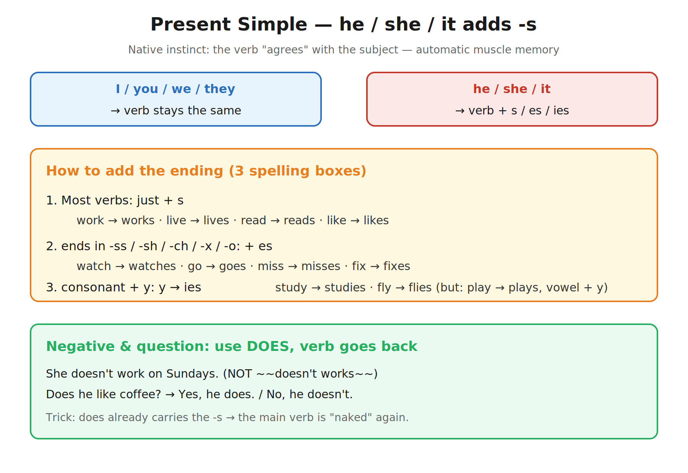
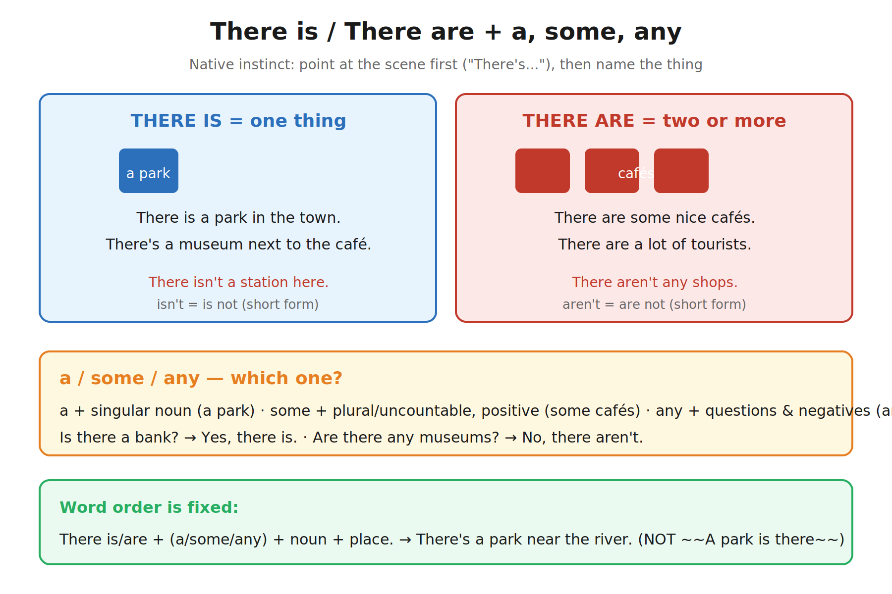
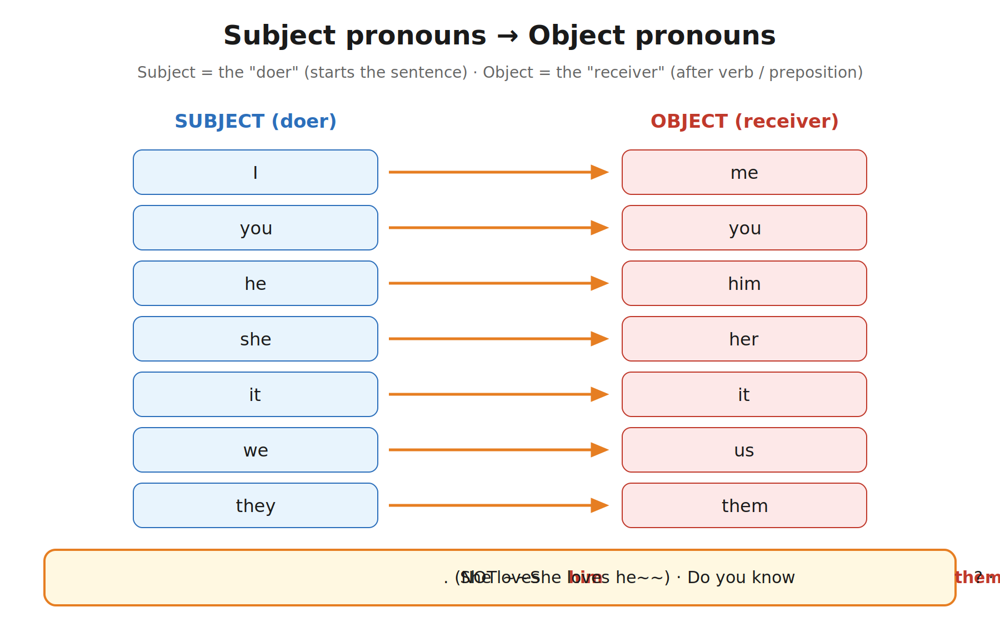
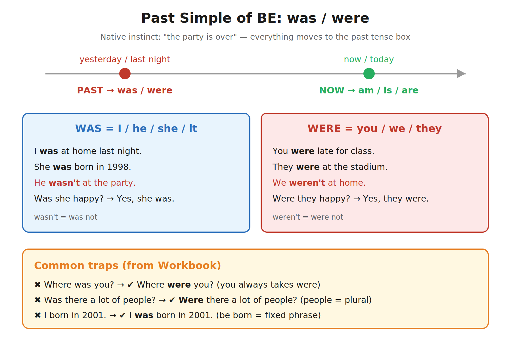
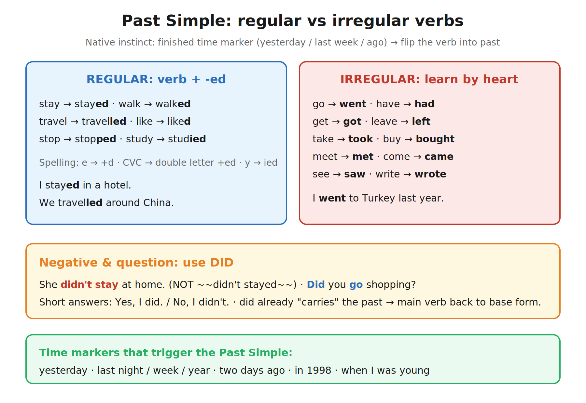
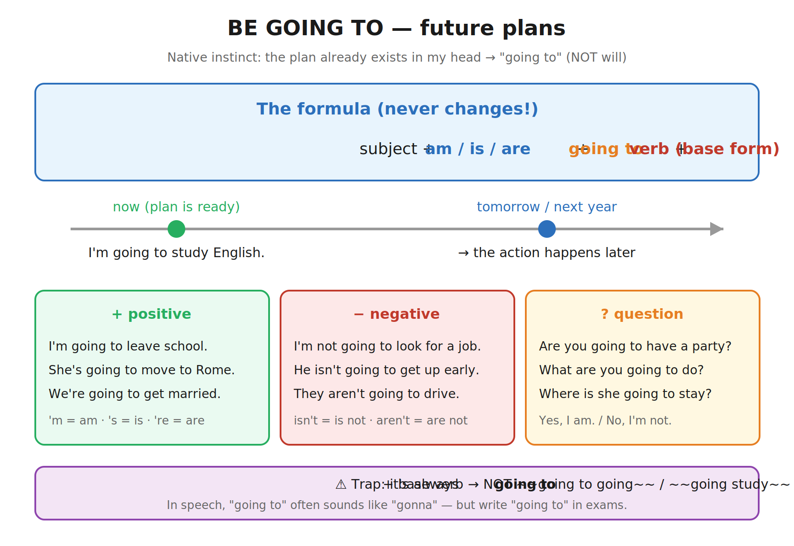

# Face2Face Starter Units 5–10 语法详解（进阶版）

> **适用**：一口气学完 Unit 5–10 后的系统梳理。比 Units 1–5 版更详细：每个语法点都配「母语者脑内规则 → 使用场景 → 易混辨析 → Workbook 真题风格练习提示」。
> **怎么用**：先通读一遍找回语感，再用每节末的 ⚠️辨析 专治「学太多记混了」。配套：同目录 `../004. 4. Face2Face Starter Units 5-10 阅读与写作教程.md`、`../homework/`。

---

## 目录

1. [Unit 5 · Present Simple 三单（he/she/it）](#1-unit-5--present-simple-三单heseit)
2. [Unit 5 · 日常作息与时间表达](#2-unit-5--日常作息与时间表达)
3. [Unit 6 · there is / there are + a / some / any](#3-unit-6--there-is--there-are--a--some--any)
4. [Unit 6 · 城镇地点与方位介词](#4-unit-6--城镇地点与方位介词)
5. [Unit 7 · 宾格代词（object pronouns）](#5-unit-7--宾格代词object-pronouns)
6. [Unit 7 · love / like / hate + -ing 与 can 能力](#6-unit-7--love--like--hate---ing-与-can-能力)
7. [Unit 8 · 过去式 be：was / were](#7-unit-8--过去式-bewas--were)
8. [Unit 8 · 日期与年份](#8-unit-8--日期与年份)
9. [Unit 9 · 过去式：规则动词与不规则动词](#9-unit-9--过去式规则动词与不规则动词)
10. [Unit 9 · did / didn't 与时间触发词](#10-unit-9--did--didnt-与时间触发词)
11. [Unit 10 · be going to 将来计划](#11-unit-10--be-going-to-将来计划)
12. [总辨析：四组最易混的语法](#12-总辨析四组最易混的语法)
13. [语法自查表](#13-语法自查表)

---

## 1. Unit 5 · Present Simple 三单（he/she/it）



### 母语者脑内规则

英语里，动词要跟主语「配对」。**he / she / it 是一个人，动词要穿一件「-s 小外套」**——母语者三岁就会，从不想为什么，就像你从不想「一个苹果」为什么要说「一个」。你的目标也是练到不用想。

### 核心规则

| 主语 | 动词形式 | 例句 |
|---|---|---|
| I / you / we / they | 原形 | I **work** in an office. |
| he / she / it | 原形 + **-s / -es / -ies** | She **works** in an office. |

**加 -s 的三种拼法**（Workbook 常考）：

1. **大多数动词直接 + s**：work→works, live→lives, read→reads, like→likes
2. **以 -ss / -sh / -ch / -x / -o 结尾 + es**（教师用书特别提醒 -ss/-sh/-x/-zz）：
   watch→watches, go→goes, miss→misses, fix→fixes, do→does
3. **辅音字母 + y：y 变 ies**：study→studies, fly→flies, carry→carries
   ⚠️ 元音 + y 直接 + s：play→plays, enjoy→enjoys

**不规则三单**：have→**has**（不是 haves！）

### 否定与疑问：请出 does，动词脱外套

```
肯定:  She works in Bangkok.          （works 穿 -s 外套）
否定:  She doesn't work in Bangkok.   （does 后动词回原形）
疑问:  Does she work in Bangkok?      （does 提前，动词回原形）
回答:  Yes, she does. / No, she doesn't.
```

⚠️ **辨析（Workbook「Correct the mistakes」原题型）**：
- ✖ He teach English. → ✔ He teach**es** English.
- ✖ My brother haves three cars. → ✔ My brother **has** three cars.
- ✖ Does she works here? → ✔ Does she **work** here?
- ✖ She doesn't likes rock music. → ✔ She doesn't **like** rock music.

### 使用场景

- **说习惯/规律**：My son studies German at school.（他现在在学，是个常态）
- **说事实**：Water boils at 100°C.
- **转述别人的日常**（介绍家人朋友）：Fiona works in an office. Her parents live in New York.

> 💡 母语者节奏：三单的 -s 轻轻带过，重音永远在句子里最重要的那个词上——He WORKS in BANGKOK. 不要把 works 读成独立重音。

---

## 2. Unit 5 · 日常作息与时间表达

### 作息短语（教师用书强调的说法，别说错）

| 正确 ✔ | 不太地道 ✖ | 说明 |
|---|---|---|
| **have** breakfast / lunch / dinner | ~~eat breakfast~~ | 三餐固定用 have |
| **go to bed** | ~~go to sleep~~ | go to bed = 上床（动作）；go to sleep = 入睡（结果） |
| **get home** | ~~arrive home~~（可用但少） | get home = 到家，口语最常用 |
| **start / finish work** | ~~start to work~~ | work 在这里是名词 |

### 时间表达复习 + 介词

```
at:  at seven o'clock · at half past five · at midnight · at the weekend（英式）
on:  on Monday · on Monday morning · on Thursday afternoon
in:  in the morning / afternoon / evening · in the week
```

**口诀**：**at 接点（时刻），on 接天（星期/某天早中晚），in 接段（早中晚/月/年）**。

### 使用场景

- 描述自己的一天（教程里 Carol's routine 范文就是模板）：
  > I get up at 7. I have breakfast, then I leave home at 8. I start work at 9 and finish work at 5. I get home at 6 and go to bed at 11.
- 问别人的作息：What time do you get up? / Does she start work early?

---

## 3. Unit 6 · there is / there are + a / some / any



### 母语者脑内规则

看到一个场景（照片、城镇、房间），母语者的开口顺序是：**先「圈出」存在物（There's...），再报名字**。就像你指着照片说「那儿有个公园」而不是「一个公园在那儿」。

### 三种句型

| 句型 | 结构 | 例句 |
|---|---|---|
| 肯定 | There is + 单数 / There are + 复数 | There'**s** a park. There **are** some cafés. |
| 否定 | There isn't / There aren't (+ any) | There **isn't** a station. There **aren't any** shops. |
| 疑问 | Is there...? / Are there...? | **Is there** a bank? → Yes, there is. |

### a / some / any 的选择（Workbook「Choose the correct words」原题型）

| 词 | 用在哪 | 例句 |
|---|---|---|
| **a** | 单数可数名词，肯定句 | There's **a** museum. |
| **some** | 复数/不可数，肯定句 | There are **some** nice cafés. |
| **any** | 疑问句、否定句 | Are there **any** shops? · There aren't **any** hotels. |

⚠️ **辨析**：
- ✖ There is some post office. → ✔ There's **a** post office.（单数用 a）
- ✖ There are a lot of old buildings? → ✔ **Are** there a lot of old buildings?（疑问语序）
- ✖ Is there any supermarket?（口语偶见）→ ✔ Is there **a** supermarket?（问「有没有一家」用 a）/ **Are** there any supermarkets?（问「有没有一些」用 any + 复数）

### 使用场景

- 介绍家乡/城市（教程 Susan's Bath 范文）：There are beautiful buildings and a river. There's a museum with hot springs.
- 问路前先确认：Is there a supermarket near here?
- 描述房间/教室：There are twelve desks. There isn't a window.

> 💡 **there is vs it is**：There is 强调「存在」（某处有某物）；It is 强调「身份/状态」（它是什么/怎么样）。There's a park. It's big. 前者报存在，后者给评价。这是母语者天然分开的两个频道。

---

## 4. Unit 6 · 城镇地点与方位介词

### 城镇词汇（注意搭配）

- **go to** the museum / the theatre / the park / the cinema（去某类场所）
- a **shopping centre**（英式；美式叫 mall）· a **station** = train station · a **bus station**
- 发音提醒（教师用书）：building [ˈbɪldɪŋ]、museum [mjuˈziːəm]、theatre [ˈθɪətə]；shopping centre 重音在 shopping

### 方位介词（Workbook 地图题核心）

| 介词 | 意思 | 例句 |
|---|---|---|
| **opposite** | 在…对面 | The café is opposite the restaurant. |
| **next to** | 紧挨着 | The bank is next to the theatre. |
| **near** | 在…附近 | The hotel is near Market Street. |
| **on your left / right** | 在你左/右边 | It's on your right. |
| **in the centre (of)** | 在中心 | The market is in the centre. |

### 问路与指路（功能语，背下来就能用）

```
问: Excuse me, where's the post office? / Is there a supermarket near here?
指: Go along this road and turn left/right. It's on your right, next to the restaurant.
    It's over there, opposite the theatre. / That's opposite the chemist's.
回应: Thank you very much. → You're welcome. / Thanks a lot.
```

---

## 5. Unit 7 · 宾格代词（object pronouns）



### 母语者脑内规则

一个句子里，**「谁干的」用主格，「对谁干的」用宾格**。母语者说 She loves **him** 时，him 的「身份」是被爱的人——句子里的接收方。中文「她爱他」两个「他」同音，英语必须换形，这是中文母语者最大的坑。

### 对照表

| 主格（做主语） | I | you | he | she | it | we | they |
|---|---|---|---|---|---|---|---|
| **宾格**（做宾语） | **me** | you | **him** | **her** | it | **us** | **them** |

### 什么时候用宾格（两大场景）

1. **动词后面**：Do you know **him**? · She loves **me**. · Ian hates **it**.
2. **介词后面**（with / for / to...）：She plays tennis with **me**. · He never talks to **us**.

⚠️ **辨析（Workbook「Choose the correct words / Correct the mistakes」原题型）**：
- ✖ Do they know she? → ✔ Do they know **her**?
- ✖ Him never talks to we. → ✔ **He** never talks to **us**.（句首做主语用 He）
- ✖ Ed and I like Jo, but she doesn't like Ed and I. → ✔ ...doesn't like Ed and **me**.（动词后用 me）
- ⚠️ Is that **he**?（严格语法）vs Is that **him**?（口语通用）——考试写 him 更安全。

### 使用场景

- 谈论喜好（教程 Jack & Jenny）：Jack loves rock music. Jenny hates **it**.
- 谈论家人：I like my brother. My sister likes **him** too.

---

## 6. Unit 7 · love / like / hate + -ing 与 can 能力

### 喜好表达（词汇语法，教程范文的核心句型）

```
love / like / hate / don't mind + 名词或动词-ing
I love watching sport on TV.
She hates dancing.
I don't mind flying. (= 不介意)
```

**为什么加 -ing？** 母语者把 -ing 形式当成「这件事」的名词化包装——watching sport 是「看球这件事」。对比 like **football**（名词）和 like **playing** football（-ing 包装的动作），后者更强调「做这件事的过程」，日常口语里更常用。

**favourite 的位置**：my favourite thing / My favourite place **was**...（教程结尾金句模板）。favourite 前面必须有 my/your/his 等所有格。

### can / can't（Unit 7B 能力）

```
肯定: I can swim. / She can speak French.
否定: He can't play the piano.  （can't = cannot，无三单变化！）
疑问: Can you drive? → Yes, I can. / No, I can't.
```

⚠️ can 后面**永远跟动词原形**：✖ can plays → ✔ can **play**。can 没有 -s：✖ She cans → ✔ She can。

### 使用场景

- 对比两人（教程模板）：I like classical music, but my husband hates **it**.
- 说能力找工作：I can speak English and Japanese. I can't drive.

---

## 7. Unit 8 · 过去式 be：was / were



### 母语者脑内规则

把整个场景「按暂停，倒带」到过去那个时间点——be 动词整体换进过去式的盒子：**I/he/she/it → was，you/we/they → were**。没有例外，没有三单外套（he **was**，不是 ~~he were~~ 也不是 ~~he was been~~）。

### 完整变位

| | 现在 | 过去 | 过去否定 | 过去疑问 |
|---|---|---|---|---|
| I / he / she / it | am / is | **was** | wasn't (was not) | Was he...? |
| you / we / they | are | **were** | weren't (were not) | Were they...? |

### be born（固定搭配，Workbook 常考）

```
I was born in 2001.       （was born = 出生，被动语态的固定短语，背下来）
Where was Jo born?        （was 提前）
They were born in Spain.
```

⚠️ **辨析**：
- ✖ Where was you last night? → ✔ Where **were** you...?（you 永远配 were）
- ✖ Was there a lot of people? → ✔ **Were** there a lot of people?（people 是复数）
- ✖ I born in 2001. → ✔ I **was** born in 2001.
- ⚠️ was/were 后面直接跟表语：He was **happy**（形容词）/ at home（介词短语）/ a student（名词）——不需要额外动词。

### 使用场景

- 谈难忘的一天（教程 Melanie's amazing day 范文）：The stadium **was** empty at the time. The concert **was** amazing.
- 谈出生地：My father was born in Brazil.
- 谈过去的天气/感受：Last Sunday was cold. We were very tired.

---

## 8. Unit 8 · 日期与年份

### 月份与星期（专有名词首字母大写）

January, February, March, April, May, June, July, August, September, October, November, December

### 序数词（说「几号」必备）

| 规则 | 例子 |
|---|---|
| 大多数 + th | four→fourth, six→sixth, seven→seventh |
| 特殊 | one→**first**, two→**second**, three→**third**, five→**fifth** |
| 整十变 y→ie+th | twenty→twent**ieth**, thirty→thirt**ieth** |
| 二十一以上「十位不变+个位变序」 | twenty-**first**, twenty-**third** |

### 年份读法（两位两位读）

```
1998 → nineteen ninety-eight
2001 → two thousand (and) one
2013 → twenty thirteen / two thousand and thirteen
in 1998 · on 5 May · on May 5th（美式）
```

**介词**：**in** + 年/月（in 1998, in July）· **on** + 具体某天（on 5 May, on Monday）

### 使用场景

- 说生日：I was born on 12 March 1995.
- 说历史事件（Workbook 风格）：The 1998 World Cup **wasn't** in Brazil. It **was** in France.

---

## 9. Unit 9 · 过去式：规则动词与不规则动词



### 母语者脑内规则

句子里只要有「**完结的时间**」（yesterday, last week, two days ago, in 1998），动词就要跳进过去式。母语者的时间线是「现在—过去」两格，动词跟着时间格走。

### 规则动词 + -ed（拼写三种）

| 动词 | 过去式 | 规则 |
|---|---|---|
| stay, walk, like | stayed, walked, liked | 直接 +d / +ed |
| travel, stop | travel**led**, stop**ped** | 重读闭音节双写末字母 |
| study | stud**ied** | 辅音+y → ied |

### 不规则动词（Unit 9 核心词汇，必须背）

| 原形 | 过去式 | 原形 | 过去式 |
|---|---|---|---|
| go | **went** | have | **had** |
| get | **got** | leave | **left** |
| take | **took** | buy | **bought** |
| meet | **met** | come | **came** |
| see | **saw** | write | **wrote** |
| tell | **told** | say | **said** |
| know | **knew** | give | **gave** |
| is/am | **was** | are | **were** |

（教程 Mark Beaumont 加餐里还有：travel→travelled, cycle→cycled, finish→finished）

### 肯定句

```
I stayed in a hotel for two nights.     （规则）
We went to Turkey last year.            （不规则 went）
She took 300 photos in four days.       （不规则 took）
They travelled around China.            （travel→travelled 双写 l）
```

---

## 10. Unit 9 · did / didn't 与时间触发词

### 否定与疑问：请出 did，动词回原形

```
否定: They didn't stay at a hotel.   （NOT ~~didn't stayed~~）
疑问: Did you go shopping?           （NOT ~~Did you went~~）
回答: Yes, they did. / No, they didn't.
Wh-:  Where did you go? What did he say? When did they arrive?
```

⚠️ 与现在时的 does 对称：**does/did 后面动词都脱掉变化**——He doesn't **work**. / He didn't **work**.

### 时间触发词（看到它们，立刻用过去式）

| 触发词 | 例句 |
|---|---|
| yesterday | I bought a new computer **yesterday**. |
| last night / week / year | We **were** late **last week**. |
| ... ago | I bought it **four months ago**. |
| in + 过去年份 | She **was** born **in 1998**. |
| when I was young | I **lived** in Paris when I was young. |

### Help with Listening：现在时 vs 过去时（教材听力专项）

> **Does she work in an office?**（问现状/习惯）vs **Did she work in an office?**（问过去那份工作）
> 母语者靠 **does / did + 时间词** 瞬间切换频道；听的时候先抓这两个信号，再决定动词形态。

### 使用场景

- 写假期游记（教程 Nancy/Jeff/Bob&Liz 黄金骨架）：I **went** on holiday to Istanbul last year. I **stayed** in a small hotel near the sea. My favourite place **was** the Blue Mosque.
- 聊周末：What did you do at the weekend? — I **didn't** do anything special.

---

## 11. Unit 10 · be going to 将来计划



### 母语者脑内规则

「我脑子里已经有这个计划了」→ 用 **be going to**。母语者不会说 ~~I will study English tomorrow~~（那是临时决定/预言），说 **I'm going to study** 表示「早打算好了」。A1 阶段把 be going to 用熟就够，will 以后再说。

### 核心公式（永远不变）

```
主语 + am/is/are + going to + 动词原形
```

| 句型 | 例句 |
|---|---|
| + | I'm going to leave school. · She's going to move to Rome. |
| − | I'm not going to look for a job. · He isn't going to get up early. |
| ? | Are you going to have a party? · What are you going to do? |
| 回答 | Yes, I am. / No, I'm not.（注意：不能缩写成 ~~Yes, I'm~~） |

### 常用搭配短语（Workbook「phrases with have, watch, go, go to」原题）

```
have a party / have coffee · watch a film · go shopping · go to the cinema
do a course · look for a job · get married · move to + 城市 · leave school
```

⚠️ **辨析**：
- ✖ I'm going study. → ✔ I'm going **to** study.（going to 不能拆）
- ✖ She's going to studying. → ✔ She's going to **study**.（to 后用原形）
- ✖ Yes, I'm. → ✔ **Yes, I am.** / No, I'm not.（肯定简答不能缩写）
- ⚠️ going to 口语里弱读成 gonna /ˈɡənə/：I'm gonna study. 听力里要认识，**写作永远写 going to**。

### 使用场景

- 谈人生计划（教程 Sabrina & Carmen 范文）：I'm going to leave school next year. I'm going to do a course and look for a job.
- 谈周末打算：What are you going to do tomorrow? — I'm going to go shopping with my mum.
- 预测（有迹象）：Look at those clouds! It's going to rain.（看着要下雨——有证据的预测也用 going to）

---

## 12. 总辨析：四组最易混的语法

一口气学完 Unit 5–10 后最容易「串台」的四组，考前必看：

### ① does vs did

| | 现在习惯 | 过去事件 |
|---|---|---|
| 疑问 | **Does** she work here? | **Did** she work here (last year)? |
| 否定 | She **doesn't** work. | She **didn't** work. |
| 后面动词 | 原形 work | 原形 work |

**分界线**：句子里的时间词。有 yesterday/last/ago → did；没有（说的是日常）→ does。

### ② was/were vs is/are

| 过去（那个场景已结束） | 现在 |
|---|---|
| The concert **was** amazing. | The concert **is** amazing.（正演着/一般评价）|
| They **were** at the stadium. | They **are** at the stadium. |

**分界线**：同样是时间。写游记/回忆 → was/were；描述照片/现状 → is/are。教程里的范文照片题用 is（照片里的人正「在」），回忆叙事用 was。

### ③ there is vs it is

- **There's** a museum.（存在：有这么个东西）
- **It's** very famous.（状态：它怎么样）
- 合体句：There's a museum. It's near the park.（先报存在，再给信息——母语者固定顺序）

### ④ going to vs 现在进行时 vs 一般现在时（表将来）

| 形式 | 用法 | 例句 |
|---|---|---|
| **be going to** | 计划/打算（脑内已有） | I'm going to study English. |
| **Present Simple** | 时刻表/日程（客观安排） | The class **starts** at 9 tomorrow. |
| （Present Continuous 留到以后） | | |

A1 阶段：**谈自己计划 → be going to** 就对了。

---

## 13. 语法自查表

写完句子问自己（对照 homework 一起用）：

| 检查项 | ✔ 正确示例 | ✖ 常见错误 |
|---|---|---|
| 三单加 -s/-es/-ies？ | He works. She studies. It goes. | ~~He work. She studys.~~ |
| does/doesn't 后回原形？ | She doesn't work. | ~~She doesn't works.~~ |
| there is/are 跟名词数一致？ | There are some cafés. | ~~There is some cafés.~~ |
| 疑问句 a/any 用对？ | Is there a bank? Are there any shops? | ~~Are there a bank?~~ |
| 宾格放对位置？ | She loves him. with me | ~~She loves he. with I.~~ |
| can 后原形、无 -s？ | She can speak French. | ~~She cans speaks.~~ |
| was/were 与人称一致？ | Where were you? He was born... | ~~Where was you?~~ |
| 过去式动词变对？ | went, had, took, travelled | ~~goed, haved, taked, traveledded~~ |
| didn't 后回原形？ | I didn't go. | ~~I didn't went.~~ |
| going to + 原形？ | I'm going to study. | ~~I'm going study / to studying.~~ |
| 时间词与时态匹配？ | yesterday→过去式；every day→现在时 | ~~I go shopping yesterday.~~ |
| 专有名词大写？ | Monday, British, May, Istanbul | ~~monday, british~~ |

---

## 配套资源

- **课文范文与写作模板**：`../004. 4. Face2Face Starter Units 5-10 阅读与写作教程.md`
- **课后习题（Workbook 风格 + 答案）**：`../homework/004. 4. Face2Face Starter Units 5-10 课后习题.md`
- **单词导入（金山词霸逐行格式）**：`../Face2Face_Units5-10_金山词霸导入.txt`
- Units 1–5 的语法基础（be 动词、a/an、一般现在时 I/you/we/they）见 `../../lesson_03_Face2Face_Starter/grammar/语法详解.md`

> 📖 本文语法点全部对照了三本官方书：Student's Book 的 Grammar 表格、Workbook 的真实题型（Choose the correct words / Correct the mistakes / Make questions / Fill in the gaps）、Teacher's Book 的教学要点（如 have breakfast、be born、-es 拼写规则、美式 mall 等），可放心作为 Unit 5–10 的复习主材料。
